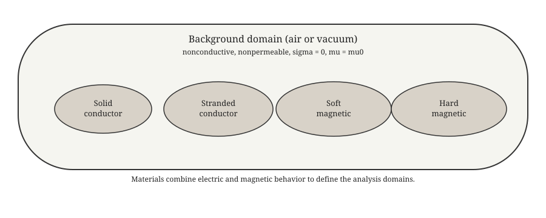

Theory
======

Electromagnetic field domains
-----------------------------

Overview
~~~~~~~~

Magnetic fields may exist as a result of an electric current, a permanent magnet, or an applied
external field. In electromagnetic analysis, components are typically categorized by their
electric and magnetic properties. These categories define which physics are active in each
sub-domain and which constitutive laws apply.

   Conceptual domain types used to organize electric and magnetic material behavior.

Domain classification
~~~~~~~~~~~~~~~~~~~~~~

Every region of the computational domain :math:`\Omega` is classified along **two independent
axes**: its **electric character** (whether, and how, it carries current) and its **magnetic
character** (whether, and how, it responds to the magnetic field). The combination of these two
attributes — together with an optional circuit-coupling attribute — fully determines which DOFs
are active and which source/constitutive terms apply in a given sub-domain.

Electric character (mutually exclusive; partitions :math:`\Omega`)
^^^^^^^^^^^^^^^^^^^^^^^^^^^^^^^^^^^^^^^^^^^^^^^^^^^^^^^^^^^^^^^^^^^

* **No current**, :math:`\Omega_0`: insulating/background region; :math:`\sigma=0`,
  :math:`\mathbf{J}_s=\mathbf{0}`. No electric DOF.
* **Stranded / source conductor**, :math:`\Omega_s`: carries a user-**imposed** current density
  :math:`\mathbf{J}_s` (e.g. a coil fed by a current source). Treated as **non-conducting**
  (:math:`\sigma=0`): eddy currents are **not** resolved inside :math:`\Omega_s`, and no
  electric-potential DOF (:math:`V`/:math:`v`) is active there. This is the "stranded conductor"
  category: current density is known and imposed, without eddy-current effects.
* **Solid (massive) conductor**, :math:`\Omega_c`: :math:`\sigma\neq0`. The current is **not**
  prescribed; it is **evaluated** self-consistently from the electric field through the
  :math:`V`/:math:`v` DOF. :math:`\Omega_c` never carries an imposed :math:`\mathbf{J}_s` — a
  region either has its current prescribed from outside (:math:`\Omega_s`) or computed from the
  field (:math:`\Omega_c`), never both directly. The two are connected only through an explicit
  circuit-coupling layer (see "Stranded coils" below).

These three regions are disjoint, :math:`\Omega=\Omega_0\cup\Omega_s\cup\Omega_c`, and this
partition is exactly the notion of *electric characteristic* used throughout this document: no
current, imposed (stranded) current, or evaluated (solid-conductor, eddy-current) current.

Magnetic character (independent attribute; may accompany any of the above)
^^^^^^^^^^^^^^^^^^^^^^^^^^^^^^^^^^^^^^^^^^^^^^^^^^^^^^^^^^^^^^^^^^^^^^^^^^^

* **Non-magnetic**: :math:`\nu=1/\mu_0` (or a similarly small, field-independent value),
  isotropic, linear — typically air, copper, aluminum, and other structural or background
  materials.
* **Soft magnetic**, :math:`\Omega_{\text{nl}}`: iron, steel, or other saturating ferromagnetic
  material described by a manufacturer B-H curve; no permanent magnetization
  (:math:`\mathbf{H}_c=\mathbf{0}`).
* **Hard magnetic**, :math:`\Omega_m`: permanent-magnet material (e.g. samarium-cobalt, Alnico,
  NdFeB), described by a (generally linear-recoil, occasionally nonlinear) B-H law **and** a
  nonzero coercive field :math:`\mathbf{H}_c` along the magnet's magnetization/easy axis.

Crucially, the magnetic character is **orthogonal** to the electric character: any of
:math:`\Omega_0,\Omega_s,\Omega_c` may independently be non-magnetic, soft-magnetic, or
hard-magnetic. A solid conductor may simultaneously carry eddy currents and saturate (e.g. a
structural steel component); a stranded/source coil may be wound around, or embedded in, a
permanent-magnet holder; a permanent magnet is ordinarily non-conducting
(:math:`\Omega_m\subset\Omega_0`) but need not be. Because of this, the magnetization source
term contributed by :math:`\mathbf{H}_c` is tied only to the magnetic character of a region, and
must be included in the governing equations **regardless of whether that region is conducting,
source, or field-free** — see "Unified constitutive law and magnetization" below.

Resulting domain catalogue
^^^^^^^^^^^^^^^^^^^^^^^^^^^

The combinations used in this document are:

#. **Non-magnetic background (air)** — non-magnetic, :math:`\Omega_0`: the free-space/insulating
   background region; no current, no B-H curve, no magnetization.
#. **Soft-magnetic material** — :math:`\Omega_{\text{nl}}`, electrically :math:`\Omega_0` unless
   separately marked conducting: iron/steel cores described by a B-H curve.
#. **Hard-magnetic material** — :math:`\Omega_m`, electrically :math:`\Omega_0` in the ordinary
   case: permanent magnets, carrying a B-H law and a coercive field
   :math:`\mathbf{H}_c\neq\mathbf{0}`.
#. **Stranded / source conductor**, :math:`\Omega_s` — imposed :math:`\mathbf{J}_s`,
   non-conducting; may additionally be soft- or hard-magnetic.
#. **Solid conductor**, :math:`\Omega_c` — :math:`\sigma\neq0`, current evaluated through the
   :math:`V`/:math:`v` DOF, no imposed :math:`\mathbf{J}_s`; may additionally be soft- or
   hard-magnetic; may optionally be **circuit-coupled** to an external network at its terminals.
#. **Stranded coils** — a circuit-coupled variant of the stranded/source conductor, in which the
   net coil current (rather than the pointwise :math:`\mathbf{J}_s` distribution) is driven or
   constrained by an external circuit equation. See the dedicated placeholder section,
   `Stranded coils (circuit coupling)`_, below; this is introduced here for completeness and
   will be developed in a later revision of this document.

Table form
^^^^^^^^^^

.. list-table:: Domain catalogue
   :header-rows: 1

   * - Domain
     - Electric character
     - Magnetic character
     - Notes
   * - Air / background
     - none (:math:`\Omega_0`)
     - non-magnetic
     - :math:`\sigma=0,\ \mathbf{J}_s=0,\ \mathbf{H}_c=0`
   * - Soft-magnetic structure
     - none, unless also :math:`\Omega_c`
     - :math:`\Omega_{\text{nl}}`
     - B-H curve, :math:`\mathbf{H}_c=0`
   * - Hard-magnetic (PM)
     - none, ordinarily
     - :math:`\Omega_m`
     - B-H law, :math:`\mathbf{H}_c\neq0`
   * - Stranded/source conductor
     - imposed (:math:`\Omega_s`)
     - any
     - :math:`\sigma=0`; :math:`\mathbf{J}_s` known
   * - Solid conductor
     - evaluated (:math:`\Omega_c`)
     - any
     - :math:`\sigma\neq0`; :math:`\mathbf{J}_s=0`; optional circuit coupling
   * - Stranded coils
     - imposed, circuit-coupled
     - any
     - placeholder, see below

Notation
--------

This section collects, in one place, every symbol used throughout the document. Symbols are
grouped by category; where a symbol carries units these are noted. Symbols are also
(re-)introduced at their first point of use in each section, so that each section remains
readable on its own.

Domains
~~~~~~~

* :math:`\Omega \subset \mathbb{R}^3` (or :math:`\mathbb{R}^2` in the 2D formulation) — the
  computational domain.
* :math:`\Omega_0 \subseteq \Omega` — the **no-current** sub-domain (:math:`\sigma=0`,
  :math:`\mathbf{J}_s=0`); e.g. air/background and (electrically) unfed magnetic structures.
* :math:`\Omega_s \subseteq \Omega` — the **stranded / source** sub-domain, carrying an
  imposed current density :math:`\mathbf{J}_s` and non-conducting (:math:`\sigma=0`).
* :math:`\Omega_c \subseteq \Omega` — the **solid-conductor** sub-domain (:math:`\sigma \neq
  0`), where eddy currents and the electric scalar potential are solved for; carries no imposed
  :math:`\mathbf{J}_s`.
* :math:`\Omega_0,\Omega_s,\Omega_c` partition :math:`\Omega` by electric character:
  :math:`\Omega=\Omega_0\cup\Omega_s\cup\Omega_c`, pairwise disjoint.
* :math:`\Omega_{\text{nl}} \subseteq \Omega` — the **nonlinear magnetic** sub-domain (saturating
  soft-magnetic material, e.g. laminated steel); may overlap any of :math:`\Omega_0,\Omega_s,
  \Omega_c`.
* :math:`\Omega_{\text{lin}} \subseteq \Omega` — the **linear magnetic** sub-domain (constant
  reluctivity, possibly anisotropic; includes air and non-saturating materials as the isotropic
  special case), :math:`\Omega_{\text{lin}}=\Omega\setminus\Omega_{\text{nl}}`.
* :math:`\Omega_m \subseteq \Omega_{\text{lin}}` — the **permanent-magnet** sub-domain, carrying
  a nonzero coercive field; may overlap any of :math:`\Omega_0,\Omega_s,\Omega_c` (ordinarily
  :math:`\Omega_m\subseteq\Omega_0`).
* :math:`\partial\Omega` — the boundary of :math:`\Omega`.
* :math:`e` — an individual finite element; :math:`\hat{e}` — the corresponding reference
  element.

Continuous electromagnetic fields
~~~~~~~~~~~~~~~~~~~~~~~~~~~~~~~~~

* :math:`\mathbf{E}` — electric field, ``[V/m]``.
* :math:`\mathbf{H}` — magnetic field, ``[A/m]``.
* :math:`\mathbf{B}` — magnetic flux density, ``[T]``; :math:`B \equiv |\mathbf{B}|` its
  magnitude.
* :math:`\mathbf{D}` — electric flux density, ``[C/m^2]``.
* :math:`\rho` — free electric charge density, ``[C/m^3]``.
* :math:`\mathbf{J}` — total current density, ``[A/m^2]``, equal to :math:`\mathbf{J}_s` in
  :math:`\Omega_s`, to :math:`\mathbf{J}_c` in :math:`\Omega_c`, and to zero in :math:`\Omega_0`.
* :math:`\mathbf{J}_s` — externally **imposed** (stranded/source) current density,
  ``[A/m^2]``, nonzero only in :math:`\Omega_s`, treated as known data.
* :math:`\mathbf{J}_c` — **conduction** current density computed self-consistently from the
  electric field in a solid conductor, :math:`\mathbf{J}_c = \boldsymbol{\sigma}\mathbf{E}`,
  nonzero only in :math:`\Omega_c`.
* :math:`\mathbf{J}_i,\ \mathbf{E}_i` — the induction-related part of the current/field
  (associated with :math:`\partial\mathbf{B}/\partial t`), defined in :math:`\Omega_c`.
* :math:`\mathbf{E}_c` — the conduction (potential-driven) part of the electric field, defined in
  :math:`\Omega_c`.

Potentials
~~~~~~~~~~

* :math:`\mathbf{A}(\mathbf{x},t)` — magnetic vector potential, ``[Wb/m]``, such that
  :math:`\mathbf{B}=\nabla\times\mathbf{A}`, active on all of :math:`\Omega`.
* :math:`V(\mathbf{x},t)` — **electric scalar potential** (non time-integrated), ``[V]``,
  active only on :math:`\Omega_c`.
* :math:`v(\mathbf{x},t)` — **time-integrated electric scalar potential**, ``[V`` :math:`\cdot`
  ``s]``, active only on :math:`\Omega_c`, defined by

  .. math::

     v(\mathbf{x},t) = \int_0^t V(\mathbf{x},\tau)\, d\tau,
     \qquad
     V = \partial_t v.

  Throughout this document :math:`V` denotes the physical voltage/potential and :math:`v` its
  time integral; the two are related by a simple time derivative, and either may be chosen as
  the solved-for finite-element unknown depending on the element technology (see the dedicated
  sub-sections below).

Material properties
~~~~~~~~~~~~~~~~~~~

* :math:`\mu` — magnetic permeability, ``[H/m]``; :math:`\mu_0=4\pi\times10^{-7}` H/m the
  permeability of free space; :math:`\mu_r=\mu/\mu_0` relative permeability.
* :math:`\nu = 1/\mu` — magnetic **reluctivity**, ``[m/H]``, the inverse of permeability.
* :math:`\boldsymbol{\nu}` — the reluctivity **tensor**, used generically where the material may
  be anisotropic; :math:`\boldsymbol{\nu}_0=\mathrm{diag}(\nu_{0,x},\nu_{0,y},\nu_{0,z})` its
  constant, diagonal, local-axis form for a linear orthotropic material.
* :math:`\sigma` — electrical conductivity, ``[S/m]`` (scalar or, more generally,
  :math:`\boldsymbol{\sigma}` a conductivity tensor); nonzero only in :math:`\Omega_c`.
* :math:`\epsilon` — electric permittivity, ``[F/m]`` (appears only in the full
  Ampere-Maxwell law; neglected under the magneto-quasi-static approximation used throughout).
* :math:`\mathbf{H}_c` — the **coercive field** of a permanent magnet, ``[A/m]``, defined along
  the magnet's magnetization/easy axis; nonzero only in :math:`\Omega_m`; a fixed material
  property, independent of the solution.

**Unified view.** Every one of the coefficients above — :math:`\mu` (or :math:`\nu`),
:math:`\sigma`, and :math:`\mathbf{H}_c` — is, in general:

#. **piecewise-defined over the domain catalogue**, taking a (possibly zero) value on each
   sub-domain of the classification above, rather than a single global constant;
#. **possibly anisotropic**, i.e. a full or diagonal :math:`3\times3` (or :math:`2\times2` in
   2D) tensor rather than a scalar, when the underlying material is orthotropic (e.g. laminated
   steel) or when a magnet's easy axis is not aligned with the global frame;
#. **possibly field-dependent (nonlinear)**, i.e. :math:`\nu=\nu(\mathbf{B})` rather than a
   constant, in :math:`\Omega_{\text{nl}}`; :math:`\sigma` and :math:`\mathbf{H}_c` are taken as
   field-independent throughout this document;
#. **expressed in a local material frame** :math:`\mathsf{R}_e` when anisotropic, and rotated
   into the global frame once per element/Gauss point before assembly (see "Element (material)
   coordinate systems" below).

Only in the simplest case — isotropic, linear, and uniform within a sub-domain — does a
coefficient reduce to a single global scalar. Every formulation in this document is written in
the general per-element, per-Gauss-point form; the familiar linear, isotropic case is always
recovered by setting the tensor to :math:`\nu\mathbf{I}` (constant) and dropping the frame
rotation.

Discrete (finite-element) fields and degrees of freedom
~~~~~~~~~~~~~~~~~~~~~~~~~~~~~~~~~~~~~~~~~~~~~~~~~~~~~~~

* Subscript :math:`h` (e.g. :math:`\mathbf{A}_h,\, \mathbf{B}_h,\, V_h`) denotes the
  finite-element (discretized) approximation of the corresponding continuous field.
* :math:`N_i(\mathbf{x})` — scalar nodal (Lagrange) shape function associated with mesh node
  :math:`i`.
* :math:`\mathbf{W}_k(\mathbf{x})` — vector **edge (Nedelec)** shape function associated with
  mesh edge :math:`k`, used to interpolate :math:`\mathbf{A}` in edge-based element
  technologies.
* :math:`\mathbf{N}_A(\mathbf{x})` — block-diagonal nodal vector shape-function matrix used to
  interpolate :math:`\mathbf{A}` component-wise in **nodal** vector-potential element
  technologies.
* :math:`a_k = \int_{L_k}\mathbf{A}\cdot d\mathbf{l}` — the edge-flux (circulation) degree of
  freedom associated with edge :math:`L_k`, in edge-based element technologies.
* :math:`\mathbf{a}_e` — the element vector of magnetic-potential degrees of freedom (edge
  circulations, or nodal vector-potential components, depending on element technology).
* :math:`\mathbf{V}_e,\ \mathbf{v}_e` — element vectors of nodal degrees of freedom for the
  non-integrated and time-integrated electric scalar potential, respectively, defined only over
  elements in :math:`\Omega_c`.
* :math:`\mathbf{x}_e = [\mathbf{a}_e;\, \mathbf{V}_e]` or :math:`[\mathbf{a}_e;\,\mathbf{v}_e]`
  — the combined element unknown vector, depending on which potential variant is used.
* :math:`N_e` — total number of magnetic-potential (edge or nodal-vector) degrees of freedom in
  the mesh; :math:`N_n` — total number of scalar-potential nodal degrees of freedom;
  :math:`\mathbf{a}\in\mathbb{R}^{N_e},\ \mathbf{V}\in\mathbb{R}^{N_n}` (or
  :math:`\mathbf{v}\in\mathbb{R}^{N_n}`) the corresponding **global** assembled unknown vectors.

Differential operators on the discrete basis
~~~~~~~~~~~~~~~~~~~~~~~~~~~~~~~~~~~~~~~~~~~~

* :math:`\mathbf{C}(\mathbf{x}) \equiv \nabla\times\mathbf{W}(\mathbf{x})` — the matrix of
  shape-function curls, mapping edge-flux DOFs to the discrete flux density,
  :math:`\mathbf{B}_h=\mathbf{C}\,\mathbf{a}_e` (edge-based technology); the corresponding
  single-basis-function curl is written :math:`\mathbf{C}_k=\nabla\times\mathbf{W}_k`.
* :math:`\mathbf{C}_A(\mathbf{x}) \equiv \nabla\times\mathbf{N}_A(\mathbf{x})` — the analogous
  curl operator for nodal vector-potential technologies.
* :math:`\mathbf{B}_A(\mathbf{x})` — the analogous "curl" operator for the 2D scalar-potential
  formulation (planar or axisymmetric), mapping :math:`\mathbf{a}_e` to the in-plane flux
  density components; see the 2D formulation below.
* :math:`\mathbf{G}(\mathbf{x}) \equiv \nabla\mathbf{N}(\mathbf{x})` — the matrix of nodal shape
  function gradients, mapping scalar-potential DOFs to the discrete potential gradient,
  :math:`\nabla V_h = \mathbf{G}\,\mathbf{V}_e`.
* :math:`\mathbf{D}_A(\mathbf{x})` — operator mapping nodal vector-potential DOFs to the discrete
  divergence :math:`\nabla\cdot\mathbf{A}_h`, used only in the nodal-technology Coulomb-gauge
  stabilization term.

Element geometry and mapping
~~~~~~~~~~~~~~~~~~~~~~~~~~~~

* :math:`\boldsymbol{\xi}` — coordinates on the reference element :math:`\hat{e}`.
* :math:`\mathbf{x}_e(\boldsymbol{\xi})` — the geometric mapping from the reference element to
  physical space.
* :math:`J_e(\boldsymbol{\xi}) = \partial\mathbf{x}/\partial\boldsymbol{\xi}` — the geometric
  (mesh) Jacobian of that mapping; :math:`\det J_e` its determinant.
* Hatted quantities (e.g. :math:`\hat{\mathbf{W}}_k,\ \hat{\mathbf{C}}_k,\ \hat{N}_i`) denote the
  corresponding shape function (or operator) defined directly on the reference element, prior to
  any geometric (Piola) mapping.
* :math:`g` — index of a quadrature (Gauss) point; :math:`\hat{\omega}_g` its reference-element
  weight; :math:`\mathbf{x}_g \equiv \mathbf{x}_e(\boldsymbol{\xi}_g)` its physical-space
  location.

Material (local) coordinate systems
~~~~~~~~~~~~~~~~~~~~~~~~~~~~~~~~~~~

* :math:`\mathsf{R}_e \in SO(3)` (or :math:`SO(2)` in 2D) — the element-constant orthogonal
  rotation matrix mapping a global-frame vector into the element's local material
  (orthotropy/magnetization) axes, :math:`\mathbf{u}_{\text{loc}}=\mathsf{R}_e\,
  \mathbf{u}_{\text{glob}}`, with :math:`\mathsf{R}_e^{-1}=\mathsf{R}_e^{T}`. This is
  geometric/material orientation data, fixed and independent of the solution; it is distinct
  from, and not to be confused with, the mesh Jacobian :math:`J_e`.
* Subscript "loc" / "glob" on a field or tensor denotes its representation in local material
  axes / the global Cartesian frame, respectively.

Nonlinear constitutive quantities
~~~~~~~~~~~~~~~~~~~~~~~~~~~~~~~~~

* :math:`b(H)` — the manufacturer-supplied :math:`B`-:math:`H` curve, with :math:`H` as the
  independent variable (as customarily plotted).
* :math:`h(B) = b^{-1}(H)` — the **inverted** curve, with :math:`B` as the independent variable
  (required since the vector-potential formulation computes :math:`\mathbf{B}` directly);
  :math:`h'(B) \equiv dH/dB` its slope.
* :math:`\nu(B) = h(B)/B` — the **secant** (chord) reluctivity derived from :math:`h`.
* :math:`\nu'(B^2) \equiv d\nu/d(B^2)` — the derivative of the secant reluctivity with respect
  to :math:`B^2`, appearing in the nonlinear tangent tensor.
* :math:`\alpha(B) \equiv \nu(B)`, :math:`\beta(B) \equiv h'(B)` — the **secant/tangent** pair
  used as a numerically robust alternative to :math:`\nu,\nu'` in the tangent-tensor expression.
* :math:`\hat{\mathbf{b}} = \mathbf{B}/B` — the unit vector along the local flux-density
  direction.
* :math:`\boldsymbol{\nu}_{\text{diff}}(\mathbf{B})` — the **differential (tangent) reluctivity
  tensor**, i.e. the Jacobian of :math:`\mathbf{H}_{\text{flux}}(\mathbf{B})` with respect to
  :math:`\mathbf{B}`.
* :math:`\mathbf{H}_{\text{flux}}(\mathbf{B})` — the state-dependent part of the constitutive
  law only, excluding any constant coercive-field offset; see "Unified constitutive law and
  magnetization" below.

Time discretization
~~~~~~~~~~~~~~~~~~~

* :math:`t^n,\ t^{n+1}` — the discrete time levels, with time-step size
  :math:`\Delta t = t^{n+1}-t^n`.
* Superscript :math:`n` on a quantity denotes its **known, converged** value at :math:`t^n`;
  superscript :math:`n+1` (often omitted on the primary unknowns for brevity) denotes the value
  being solved for at :math:`t^{n+1}`.
* :math:`\theta \in (0,1]` — the parameter of the generalized trapezoidal (Euler-:math:`\theta`)
  time-integration scheme; :math:`\theta=1` recovers backward Euler, :math:`\theta=1/2` the
  trapezoidal (Crank-Nicolson) rule.
* :math:`\dot{(\cdot)}` — a time derivative; :math:`\dot{\mathbf{a}}^n,\ \dot{\mathbf{v}}^n` (or
  :math:`\dot{\mathbf{V}}^n`) denote **stored rate vectors**, carried from one time step to the
  next in the generalized-:math:`\theta` scheme.

Newton-Raphson iteration
~~~~~~~~~~~~~~~~~~~~~~~~

* :math:`k` — the Newton iteration index within a given time step; a superscript :math:`k` on
  the unknowns (e.g. :math:`\mathbf{a}^k`) denotes the current iterate.
* :math:`\delta\mathbf{a},\ \delta\mathbf{v}` (or :math:`\delta\mathbf{V}`) — the Newton update
  (correction) computed by solving the linearized system at each iteration.
* :math:`R^A,\ R^V` (or :math:`R^v`) — the discrete residual vectors of the magnetic and
  electric-potential equations, respectively; driven to zero (within tolerance) by Newton
  iteration.
* :math:`K^{AA},\, K^{AV},\, K^{VA},\, K^{VV}` (analogously with :math:`v`) — the blocks of the
  Jacobian (tangent stiffness) matrix, i.e. the partial derivatives of the residuals with
  respect to the unknowns.

Geometry-reduction quantities specific to the 2D (PLANE233) formulation
~~~~~~~~~~~~~~~~~~~~~~~~~~~~~~~~~~~~~~~~~~~~~~~~~~~~~~~~~~~~~~~~~~~~~~~

* :math:`t = \mathrm{THK}` — the out-of-plane thickness in the planar case.
* :math:`f = \mathrm{THK}` — the fraction of :math:`360^\circ` modeled in the axisymmetric case.
* :math:`w_{\text{geom}}` — the geometric weight converting a 2D area integral into an
  equivalent 3D volume integral (:math:`t` for planar, :math:`2\pi f r` for axisymmetric).
* :math:`\ell` — the out-of-plane (or circumferential) length over which the lumped potential
  drop :math:`V` acts (:math:`\ell=t` planar, :math:`\ell=2\pi f r` axisymmetric).

Maxwell equations for the eddy-current regime
-----------------------------------------------

Scope and assumptions
~~~~~~~~~~~~~~~~~~~~~

The **eddy-current regime** refers to electromagnetic phenomena where **time-varying magnetic
fields induce currents** in conducting media, while **wave propagation effects are negligible**.
This is typically modeled with the **magneto-quasi-static (MQS)** approximation, in which the
displacement current is neglected in Ampere's law. All fields and material properties used
below are defined in the Notation section above.

Material laws (generic form):

* :math:`\mathbf{B} = \mu \mathbf{H}` (or the general constitutive law of the next section, when
  the magnetization/nonlinearity of the material is not neglected)
* :math:`\mathbf{D} = \epsilon \mathbf{E}`

Governing Maxwell equations
~~~~~~~~~~~~~~~~~~~~~~~~~~~

In differential form, Maxwell's equations are:

1. **Gauss's law (electric):**

   .. math::

      \nabla \cdot \mathbf{D} = \rho

2. **Gauss's law (magnetic):**

   .. math::

      \nabla \cdot \mathbf{B} = 0

3. **Faraday's law (electromagnetic induction):**

   .. math::

      \nabla \times \mathbf{E} = - \frac{\partial \mathbf{B}}{\partial t}

4. **Ampere-Maxwell law (full form):**

   .. math::

      \nabla \times \mathbf{H} = \mathbf{J} + \frac{\partial \mathbf{D}}{\partial t}

Eddy-current (MQS) approximation
~~~~~~~~~~~~~~~~~~~~~~~~~~~~~~~~

In the eddy-current regime, the displacement current term is neglected:

.. math::

   \frac{\partial \mathbf{D}}{\partial t} \approx \mathbf{0}

so Ampere's law reduces to:

.. math::

   \nabla \times \mathbf{H} = \mathbf{J}

This approximation is valid when the characteristic length scales are small compared to the
electromagnetic wavelength and when capacitive effects are negligible relative to conductive
effects.

Current density: a domain-based, mutually exclusive statement
~~~~~~~~~~~~~~~~~~~~~~~~~~~~~~~~~~~~~~~~~~~~~~~~~~~~~~~~~~~~~

Rather than allowing an imposed and an evaluated current to coexist in the same region, this
document assigns the current density strictly **per the domain classification** introduced
above:

.. math::

   \mathbf{J}(\mathbf{x}) =
   \begin{cases}
   \mathbf{0}, & \mathbf{x}\in\Omega_0, \\[4pt]
   \mathbf{J}_s(\mathbf{x}), & \mathbf{x}\in\Omega_s
   \quad \text{(imposed, known input)}, \\[4pt]
   \mathbf{J}_c(\mathbf{x}) = \boldsymbol{\sigma}\mathbf{E}(\mathbf{x})
   = \boldsymbol{\sigma}(\mathbf{E}_i+\mathbf{E}_c), & \mathbf{x}\in\Omega_c
   \quad \text{(evaluated, self-consistent)}.
   \end{cases}

**Interpretation**

* In the **stranded/source** region :math:`\Omega_s`, :math:`\mathbf{J}=\mathbf{J}_s` is a known
  body load; :math:`\sigma\equiv0` there, so no conduction or induction term is generated, and no
  electric-potential DOF is needed.
* In the **solid-conductor** region :math:`\Omega_c`, the current is computed self-consistently
  from the electric field. The **induction component** (:math:`\mathbf{J}_i=\sigma\mathbf{E}_i`)
  captures eddy currents generated by Faraday's law due to :math:`\partial\mathbf{B}/\partial
  t`; the **conduction component** (:math:`\mathbf{J}_c'=\sigma\mathbf{E}_c`, driven by
  :math:`-\nabla V` or :math:`-\nabla\dot v`) captures currents driven by a potential difference
  or by an external circuit/terminal condition. There is, by construction, **no imposed**
  :math:`\mathbf{J}_s` in :math:`\Omega_c`: any net current through a solid conductor is
  established through its terminal boundary conditions or circuit coupling, not through a
  pointwise body-force current density.

Ampere's law then reads, piecewise:

.. math::

   \nabla\times\mathbf{H} =
   \begin{cases}
   \mathbf{0}, & \Omega_0,\\
   \mathbf{J}_s, & \Omega_s,\\
   \boldsymbol{\sigma}\mathbf{E}, & \Omega_c,
   \end{cases}

with :math:`\mathbf{H}` given everywhere by the unified constitutive law of the next section
(which is where the permanent-magnet source enters, independently of this current
classification).

Unified constitutive law and magnetization
--------------------------------------------

This section introduces, once, the constitutive relation between :math:`\mathbf{H}` and
:math:`\mathbf{B}` used by **every** formulation in this document — 2D and 3D, linear and
nonlinear, conducting and non-conducting. Presenting it up front avoids repeating the
magnetization source term separately in each discretization, and makes explicit that it is
active in **any** domain with a nonzero coercive field, independent of its electric character.

Material regions (recap)
~~~~~~~~~~~~~~~~~~~~~~~~

.. math::

   \Omega = \Omega_{\text{nl}} \cup \Omega_{\text{lin}}, \qquad
   \Omega_m \subseteq \Omega_{\text{lin}} \ \ (\text{permanent-magnet regions}),

with :math:`\Omega_{\text{nl}},\Omega_{\text{lin}},\Omega_m` as defined in the Notation section.
This magnetic-character partition is independent of, and may freely overlap, the electric
partition :math:`\Omega_0\cup\Omega_s\cup\Omega_c` introduced above.

Constitutive models
~~~~~~~~~~~~~~~~~~~~

**Nonlinear (soft-magnetic) regions**, :math:`\Omega_{\text{nl}}` — isotropic, saturating
material described by a single scalar B-H curve applied uniformly regardless of field direction:

.. math::

   \mathbf{H}_{\text{flux}}(\mathbf{B}) = \nu(B)\,\mathbf{B},
   \qquad
   B = |\mathbf{B}| = \sqrt{\mathbf{B}\cdot\mathbf{B}},

with :math:`\nu(B)` the field-dependent secant reluctivity defined below.

**Linear regions**, :math:`\Omega_{\text{lin}}` — diagonal, constant reluctivity in local
material axes (covers isotropic air/copper as the trivial case
:math:`\nu_{0,x}=\nu_{0,y}=\nu_{0,z}=1/\mu_0`, and orthotropic linear approximations such as
laminated stacks):

.. math::

   \mathbf{H}_{\text{flux,loc}} = \boldsymbol{\nu}_0\,\mathbf{B}_{\text{loc}},
   \qquad
   \boldsymbol{\nu}_0 = \mathrm{diag}(\nu_{0,x},\nu_{0,y},\nu_{0,z})\ \ (\text{constant}),
   \qquad
   \mathbf{H}_{\text{flux,glob}}=\mathsf{R}_e^T\mathbf{H}_{\text{flux,loc}},

with :math:`\mathbf{B}_{\text{loc}}=\mathsf{R}_e\mathbf{B}` the flux density expressed in the
element's local material axes.

**Permanent-magnet regions**, :math:`\Omega_m`, add a constant coercive-field offset, kept as a
**separate, additive source contribution** rather than folded into the constitutive slope:

.. math::

   \mathbf{H}(\mathbf{x}) = \mathbf{H}_{\text{flux}}(\mathbf{B}(\mathbf{x}))
   - \mathbf{H}_{c,\text{glob}}(e)\, \mathbb{1}_{\Omega_m}(\mathbf{x}),
   \qquad
   \mathbf{H}_{c,\text{glob}}(e) = \mathsf{R}_e^{T}\,\mathbf{H}_{c,\text{loc}}(e),

with :math:`\mathbf{H}_{c,\text{loc}}(e)` the (element-constant) coercive field in local magnet
axes, of magnitude taken from the magnet datasheet and direction along the
magnetization/easy axis, and :math:`\mathbb{1}_{\Omega_m}` the indicator function of the
permanent-magnet region.

This single boxed relation,

.. math::

   \boxed{\mathbf{H}(\mathbf{x}) = \mathbf{H}_{\text{flux}}(\mathbf{B}(\mathbf{x}))
   - \mathbf{H}_{c,\text{glob}}(e)\,\mathbb{1}_{\Omega_m}(\mathbf{x}),}

is what every weak form below contracts against the appropriate curl/gradient test operator. It
is deliberately written **independently of the electric character** of the element: whether the
element in question belongs to :math:`\Omega_0`, :math:`\Omega_s`, or :math:`\Omega_c` has no
bearing on whether the magnetization term is present — only membership in :math:`\Omega_m` does.
Consequently the magnetization/coercive-field source term appears in the :math:`\mathbf{A}`
weak-form equation of **every** formulation below — linear or nonlinear, 2D or 3D — not only in
a dedicated "nonlinear" section.

**Linear case as a special case.** Setting :math:`\Omega_{\text{nl}}=\emptyset` (so
:math:`\Omega=\Omega_{\text{lin}}` and :math:`\nu` is constant, element-wise) reduces
:math:`\mathbf{H}_{\text{flux}}` to the ordinary linear law
:math:`\mathbf{H}_{\text{flux,glob}}=\mathsf{R}_e^T\boldsymbol{\nu}_0\mathsf{R}_e\,\mathbf{B}`,
with the magnetization term unchanged. All "linear formulation" sections below are exactly this
special case; no Newton iteration is required there because :math:`\mathbf{H}` is then linear in
:math:`\mathbf{B}` and the element matrices are state-independent.

B-H curve inversion and differential reluctivity
~~~~~~~~~~~~~~~~~~~~~~~~~~~~~~~~~~~~~~~~~~~~~~~~

Manufacturer B-H data is supplied as :math:`B=b(H)`, i.e. :math:`H` is the independent variable
as customarily plotted. Since the :math:`\mathbf{A}`-formulation computes
:math:`\mathbf{B}=\nabla\times\mathbf{A}_h` (or, in 2D, :math:`\mathbf{B}_h=\mathbf{B}_A(g)\,
\mathbf{a}_e`) directly, the constitutive law is needed in the **inverse** direction,

.. math::

   H = h(B) \equiv b^{-1}(H),

obtained (as a pre-processing step, prior to any Newton iteration) by inverting the supplied
curve and fitting a **monotone** interpolant (e.g. a PCHIP / monotone Hermite spline) to
:math:`h(B)`, so that the slope :math:`h'(B)\equiv dH/dB` is guaranteed non-negative between
data points — an ordinary (non-monotonicity-preserving) cubic spline can overshoot and produce a
locally negative slope, which would render the tangent stiffness indefinite. The curve is
constrained to pass through the origin, :math:`h(0)=0` (odd symmetry, no hysteresis/remanence
assumed for the soft-magnetic curve), and is extrapolated beyond the last supplied data point
with the asymptotic slope :math:`h'(B)\to 1/\mu_0` (rather than extrapolating the spline
itself), since manufacturer data rarely extends far enough into deep saturation and early Newton
iterates can overshoot into that region.

From :math:`h(B)`, the **secant reluctivity** is

.. math::

   \nu(B) = \frac{h(B)}{B}\ \ (B>0),
   \qquad
   \nu(0) = \frac{1}{\mu_{\text{init}}},

with :math:`\mu_{\text{init}}` the material's initial (small-signal) permeability. Its
derivative with respect to :math:`B^2` — required for the nonlinear tangent tensor below — is

.. math::

   \boxed{\nu'(B^2) \equiv \frac{d\nu}{d(B^2)}
   = \frac{h'(B) - \nu(B)}{2B^2}
   = \frac{1}{2B^2}\left(\frac{dH}{dB} - \frac{H(B)}{B}\right).}

Equivalently, and preferable numerically since it never divides by :math:`B^2`, define the
**secant/tangent pair**

.. math::

   \alpha(B) = \frac{h(B)}{B} = \nu(B)\ \ (\text{secant}),
   \qquad
   \beta(B) = h'(B) = \frac{dH}{dB}\ \ (\text{tangent slope}),

used directly in the tangent-tensor expression below. This curve-inversion machinery is shared,
unchanged, by the 2D, 3D-nodal, and 3D-edge discretizations: only the dimensionality of
:math:`\mathbf{B}` (2- or 3-component) and of the tangent tensor differs, not the scalar curve
itself.

Isotropic nonlinear tangent (differential reluctivity) tensor
~~~~~~~~~~~~~~~~~~~~~~~~~~~~~~~~~~~~~~~~~~~~~~~~~~~~~~~~~~~~~

Differentiating :math:`\mathbf{H}_{\text{flux}}=\nu(B)\mathbf{B}` with respect to the discrete
magnetic unknowns gives the field-dependent **differential reluctivity tensor**
:math:`\boldsymbol{\nu}_{\text{diff}}(\mathbf{B}) \equiv
\partial\mathbf{H}_{\text{flux}}/\partial\mathbf{B}`:

.. math::

   \boldsymbol{\nu}_{\text{diff}}(\mathbf{B})
   = \nu(B^2)\,\mathbf{I} + 2\nu'(B^2)\,\mathbf{B}\otimes\mathbf{B}
   = \alpha(B)\,\big(\mathbf{I}-\hat{\mathbf{b}}\otimes\hat{\mathbf{b}}\big)
   + \beta(B)\,\hat{\mathbf{b}}\otimes\hat{\mathbf{b}},
   \qquad
   \hat{\mathbf{b}} = \frac{\mathbf{B}}{B},

with :math:`\mathbf{I}` the identity tensor (:math:`3\times3` in 3D, :math:`2\times2` in 2D) and
:math:`\otimes` the outer (dyadic) product; the formula, and its interpretation below, is
dimension-independent. This tensor is **symmetric**, but — unlike the diagonal linear-region
tensor — **full** (transversely isotropic about the local field direction :math:`\hat{\mathbf
{b}}`): the secant value :math:`\alpha` governs the response transverse to :math:`\mathbf{B}`
(rotation of the field at constant magnitude), while the tangent slope :math:`\beta` governs the
response along :math:`\mathbf{B}` (change of field magnitude). Near saturation, :math:`\beta \ll
\alpha`, so the tangent tensor becomes strongly directionally stiff even though the underlying
material is isotropic; this is the source of ill-conditioning typically observed in deeply
saturated Newton iterations.

Because the coercive-field source term is additive and state-independent (it does not depend on
:math:`\mathbf{B}`), it contributes nothing to :math:`\boldsymbol{\nu}_{\text{diff}}`; the
tangent tensor is exactly the derivative of :math:`\mathbf{H}_{\text{flux}}` alone, in both
:math:`\Omega_{\text{nl}}` and :math:`\Omega_m\subset\Omega_{\text{lin}}`.

For an element in the **linear** branch :math:`\Omega_{\text{lin}}`, the tangent tensor is
simply the (rotated) constant :math:`\boldsymbol{\nu}_0` and does not depend on the state:

.. math::

   \boldsymbol{\nu}_{\text{diff}}(\mathbf{x}) = \mathsf{R}_e^{T}\,\boldsymbol{\nu}_0\,\mathsf{R}_e
   \qquad (\text{constant, precomputable once per element}).

Quadrature-point evaluation
~~~~~~~~~~~~~~~~~~~~~~~~~~~

The nonlinear constitutive quantities :math:`\mathbf{H}_{\text{flux}}` and
:math:`\boldsymbol{\nu}_{\text{diff}}` are **field-dependent**, hence **position-dependent**,
and must be evaluated at **every quadrature point of every element in
:math:`\Omega_{\text{nl}}`, at every Newton iteration** — never approximated by a single value
at the element centroid, and never reused across Newton iterations. Only purely
geometric/orientation data (:math:`\mathsf{R}_e,\ \mathbf{H}_{c,\text{loc}}(e)`, and the
reference shape functions) are element-constant and may be precomputed once, outside the Newton
loop.

**Nonlinear branch** (:math:`e\in\Omega_{\text{nl}}`), with :math:`\mathbf{B}_h(\mathbf{x}_g)`
the discrete flux density at Gauss point :math:`g` (see each discretization below for how it is
formed):

.. math::

   B^2 = \mathbf{B}_h\cdot\mathbf{B}_h,
   \qquad
   \nu = \nu(B^2),\ \ \nu' = \nu'(B^2)
   \qquad (\text{curve lookup, at this quadrature point, this Newton iteration}),

.. math::

   \mathbf{H}_{\text{flux}}(\mathbf{x}_g) = \nu\,\mathbf{B}_h(\mathbf{x}_g),
   \qquad
   \boldsymbol{\nu}_{\text{diff}}(\mathbf{x}_g) = \nu\,\mathbf{I} +
   2\nu'\,\mathbf{B}_h(\mathbf{x}_g)\otimes\mathbf{B}_h(\mathbf{x}_g).

**Linear branch** (:math:`e\in\Omega_{\text{lin}}`, including :math:`\Omega_m`):

.. math::

   \mathbf{B}_{\text{loc}}(\mathbf{x}_g) = \mathsf{R}_e\,\mathbf{B}_h(\mathbf{x}_g),
   \qquad
   \mathbf{H}_{\text{flux}}(\mathbf{x}_g) = \mathsf{R}_e^{T}\big(\boldsymbol{\nu}_0\,
   \mathbf{B}_{\text{loc}}(\mathbf{x}_g)\big),
   \qquad
   \boldsymbol{\nu}_{\text{diff}}(\mathbf{x}_g) = \mathsf{R}_e^{T}\boldsymbol{\nu}_0\mathsf{R}_e
   \ \ (\text{precomputed once, per element}).

In both branches, if :math:`e` also belongs to :math:`\Omega_m`, the coercive-field offset
:math:`\mathbf{H}_{c,\text{glob}}(e)` is subtracted from :math:`\mathbf{H}_{\text{flux}}` to
form :math:`\mathbf{H}` (see the boxed relation above) before assembling the residual; it never
enters :math:`\boldsymbol{\nu}_{\text{diff}}`.

Element (material) coordinate systems
~~~~~~~~~~~~~~~~~~~~~~~~~~~~~~~~~~~~~

Both nodal and edge-based technologies allow the reluctivity tensor to be defined in an
**element (material) coordinate system** that need not coincide with the global Cartesian frame
in which the mesh geometry and the edge/nodal shape functions are expressed. This is required
whenever the magnetic material is orthotropic (e.g. laminated cores, where the reluctivity
across the lamination stack differs from the in-plane reluctivity) or whenever a permanent
magnet's easy/magnetization axis is not aligned with the global axes.

**Computational remark — rotate the tensor, not the shape functions.** Since

.. math::

   \mathbf{u}^{T}\big(\mathsf{R}_e^{T}\mathsf{D}\,\mathsf{R}_e\big)\,\mathbf{v}
   = (\mathsf{R}_e\mathbf{u})^{T}\,\mathsf{D}\,(\mathsf{R}_e\mathbf{v})

for any vectors :math:`\mathbf{u},\mathbf{v}` and matrix :math:`\mathsf{D}`, the local-axis
congruence transform can be applied either to the pair of shape-function curls entering a
stiffness integrand, or — equivalently, and far more cheaply — to the :math:`3\times3` (or
:math:`2\times2`) constitutive tensor **once** per quadrature point, leaving the (global-frame)
shape functions untouched. Every formulation in this document uses the latter convention: the
reluctivity/tangent tensor is rotated into the global frame once per Gauss point, and contracted
directly with the global-frame curl/gradient operators. This reduces the per-Gauss-point cost
from :math:`O(n_{\text{dof}})` vector rotations to a single small congruence transform, reused
for every entry of the local stiffness matrix.

For an **isotropic** material (:math:`\nu_x=\nu_y=\nu_z=\nu`, or in the nonlinear case a single
scalar curve :math:`\nu(|\mathbf{B}|)`), :math:`\mathsf{R}_e` has no effect and may be omitted;
it is otherwise required for any orthotropic linear material, orthotropic per-axis nonlinear
curve set, and for permanent magnets whose coercive field is not aligned with the global axes.

2D formulation (PLANE233) — planar and axisymmetric
------------------------------------------------------

This section documents a 2D finite-element formulation aligned with the PLANE233 element
capabilities for planar and axisymmetric cases, using local notation and the PLANE233 DOFs:
``AZ`` plus optional ``VOLT`` (electric scalar potential :math:`V`) or time-integrated ``VOLT``
(:math:`v`). Both the linear (constant :math:`\nu`) and nonlinear (saturating,
:math:`\nu(\mathbf{B})`) cases are covered, sharing the same weak form and differing only in the
constitutive-law block. [1]_

Geometry reduction and the THK (out-of-plane measure)
~~~~~~~~~~~~~~~~~~~~~~~~~~~~~~~~~~~~~~~~~~~~~~~~~~~~~

Let the 2D computational domain be :math:`\Omega \subset \mathbb{R}^2`, partitioned as
:math:`\Omega=\Omega_0\cup\Omega_s\cup\Omega_c` (electric character) and
:math:`\Omega=\Omega_{\text{nl}}\cup\Omega_{\text{lin}}`, :math:`\Omega_m\subseteq
\Omega_{\text{lin}}` (magnetic character), exactly as in the general classification above.

Planar (2D "plane")
^^^^^^^^^^^^^^^^^^^

A 3D prismatic body is represented by extruding :math:`\Omega` in the out-of-plane direction
with thickness :math:`\ell \equiv t = \mathrm{THK}`. All volume integrals become

.. math::

   \int_{\Omega^{3D}} (\cdot)\, dV
   = \int_{\Omega} (\cdot)\, t\, d\Omega.

PLANE233 explicitly supports THK as thickness for the plane option. [1]_

Axisymmetric (2D r-z)
^^^^^^^^^^^^^^^^^^^^^

A 3D body is formed by revolving the meridian :math:`\Omega \subset \{(r,z): r \ge 0\}`.
PLANE233 allows modeling a fraction :math:`f = \mathrm{THK}` of the full :math:`360^\circ`. [1]_
Hence the azimuthal span is :math:`\Delta \theta_{\text{ax}} = 2\pi f`, and

.. math::

   \int_{\Omega^{3D}} (\cdot)\, dV
   = \int_{\Omega} (\cdot)\, (2\pi f\, r)\, d\Omega.

So, throughout: **planar weight** :math:`w_{\text{geom}} = t`; **axisym weight**
:math:`w_{\text{geom}} = 2\pi f\, r`.

Unknowns and fields
~~~~~~~~~~~~~~~~~~~

Magnetic potential (2D reduction)
^^^^^^^^^^^^^^^^^^^^^^^^^^^^^^^^^

PLANE233 uses a single scalar DOF representing the only nonzero component of
:math:`\mathbf{A}`, active on all of :math:`\Omega`:

* **planar:** :math:`\mathbf{A} = A(x,y,t)\, \mathbf{e}_z`
* **axisym:** :math:`\mathbf{A} = A(r,z,t)\, \mathbf{e}_\theta`

The electric-potential DOF (:math:`V` or :math:`v`) is active **only** on :math:`\Omega_c`.

Flux density (:math:`\mathbf{B}=\nabla\times\mathbf{A}`)
^^^^^^^^^^^^^^^^^^^^^^^^^^^^^^^^^^^^^^^^^^^^^^^^^^^^^^^^

**Planar (in-plane x-y)**

.. math::

   \mathbf{B} =
   \begin{bmatrix}
   \partial_y A \\
   -\partial_x A \\
   0
   \end{bmatrix}
   \equiv \mathbf{C}_{2D}\, \nabla A,
   \qquad
   \mathbf{C}_{2D} =
   \begin{bmatrix}
   0 & 1 \\
   -1 & 0
   \end{bmatrix},

where :math:`\mathbf{C}_{2D}` is the constant :math:`2\times2` rotation matrix implementing the
in-plane curl of a scalar.

**Axisymmetric (meridian r-z)**

.. math::

   B_r = -\partial_z A,
   \qquad
   B_z = \frac{1}{r}\partial_r(rA) = \partial_r A + \frac{A}{r}.

Constitutive law and magnetization
^^^^^^^^^^^^^^^^^^^^^^^^^^^^^^^^^^

The 2D flux density :math:`\mathbf{B}=(B_x,B_y)` (planar) or :math:`(B_r,B_z)` (axisym) is
substituted directly into the unified law of the previous section,

.. math::

   \mathbf{H} = \mathbf{H}_{\text{flux}}(\mathbf{B}) - \mathbf{H}_{c,\text{glob}}(e)\,
   \mathbb{1}_{\Omega_m},

with :math:`\mathbf{H}_{\text{flux}}(\mathbf{B})=\boldsymbol{\nu}_0\,\mathbf{B}` (linear,
:math:`2\times2` in-plane reluctivity) or :math:`\nu(B)\mathbf{B}` (nonlinear,
:math:`\Omega_{\text{nl}}`), and :math:`\mathbf{H}_{c,\text{glob}}(e)` the (in-plane component
of the) magnet's coercive field, nonzero only for :math:`e\in\Omega_m`.

Electric field and currents (:math:`\Omega_c` only)
^^^^^^^^^^^^^^^^^^^^^^^^^^^^^^^^^^^^^^^^^^^^^^^^^^^

The out-of-plane electric field component driving conduction is modeled, in :math:`\Omega_c`
only, via a **lumped potential drop** across the out-of-plane length :math:`\ell` (:math:`\ell=
t` planar, :math:`\ell(r)=r` with :math:`\Delta\theta_{\text{ax}}=2\pi f` axisymmetric). Define
the **electric potential drop DOF** :math:`V` (``[V]``). Then, for :math:`\mathbf{x}\in
\Omega_c`,

.. math::

   E_{\parallel} = -\partial_t A - \frac{V}{\ell},

where ":math:`\parallel`" denotes the direction along :math:`z` (planar) or :math:`\theta`
(axisym), i.e. the direction of :math:`\mathbf{A}` itself. Let :math:`\sigma` be the
conductivity in that direction (nonzero only in :math:`\Omega_c`). The evaluated current density
in :math:`\Omega_c` is

.. math::

   J_c = \sigma E_{\parallel} = -\sigma\left(\partial_t A + \frac{V}{\ell}\right),

while in :math:`\Omega_s` the current is the imposed :math:`J_s(\mathbf{x},t)`, and in
:math:`\Omega_0`, :math:`J=0`. Per PLANE233 documentation: in 2D electromagnetic regions, the
VOLT DOF represents a single voltage drop across the out-of-plane measure, enforced by coupling.
[1]_ For the **time-integrated** potential option, define :math:`v(t)=\int_0^t V(\tau)\,d\tau`,
so :math:`V=\partial_t v`, which is exactly the documented "time-integrated electric potential"
meaning of VOLT. [2]_

Governing strong form (magneto-quasistatic)
~~~~~~~~~~~~~~~~~~~~~~~~~~~~~~~~~~~~~~~~~~~

Let :math:`A` be the scalar magnetic potential DOF. The reduced Ampere law, piecewise by domain,
becomes

.. math::

   \mathcal{L}(A) =
   \begin{cases}
   0, & \Omega_0,\\
   J_s, & \Omega_s,\\
   -\sigma\left(\partial_t A + V/\ell\right), & \Omega_c,
   \end{cases}
   \qquad
   \mathcal{L}(A) \equiv -\nabla\cdot\big(\boldsymbol{\nu}(\mathbf{B})\,\nabla A\big)
   \ \text{(planar; axisym analogue below)},

with the magnetization contribution of :math:`\Omega_m` entering through
:math:`\boldsymbol{\nu}(\mathbf{B})\nabla A \to \mathbf{H}(\mathbf{B})` in the weak sense (see
below); the strong-form statement is kept schematic here since the coercive-field term is most
naturally expressed in the weak (residual) form used for assembly.

Axisymmetric
^^^^^^^^^^^^

For isotropic, linear :math:`\nu` and no magnet source, one may write

.. math::

   -\frac{1}{r}\partial_r\left(r\, \nu\, \partial_r A\right)
   - \partial_z\left(\nu\, \partial_z A\right)
   + \frac{\nu}{r^2} A
   = J;

the FE (weak) form below handles the operator robustly for the general (nonlinear, tensorial,
magnetized) case.

FE discretization (shape functions + Gauss quadrature)
~~~~~~~~~~~~~~~~~~~~~~~~~~~~~~~~~~~~~~~~~~~~~~~~~~~~~~

Let the element have :math:`n` nodes and scalar shape functions :math:`N_i(\xi,\eta)`. Collect
:math:`\mathbf{N}(\xi,\eta) = [N_1,\dots,N_n]`, so that
:math:`A_h = \mathbf{N}\, \mathbf{a}_e,\ V_h = \mathbf{N}\, \mathbf{V}_e,\ v_h = \mathbf{N}\,
\mathbf{v}_e` (:math:`V_e,v_e` defined only for elements in :math:`\Omega_c`). At Gauss point
:math:`g`: weight :math:`\omega_g`, Jacobian determinant :math:`|J_g|`, and geometry weight
:math:`w_{\text{geom}}(g)` (planar :math:`t`, axisym :math:`2\pi f r_g`).

Magnetic "curl" operator matrices
^^^^^^^^^^^^^^^^^^^^^^^^^^^^^^^^^

**Planar.** Define the in-plane shape-function gradients
:math:`\nabla N_i=[\partial_x N_i,\partial_y N_i]^T`, and the :math:`2\times n` operator
:math:`\mathbf{B}_A(g)` mapping nodal :math:`\mathbf{a}_e` to :math:`(B_x,B_y)`:

.. math::

   \mathbf{B}_A(g) =
   \begin{bmatrix}
   \partial_y \mathbf{N}(g) \\
   -\partial_x \mathbf{N}(g)
   \end{bmatrix},
   \quad
   \mathbf{b}(g) = \mathbf{B}_A(g)\, \mathbf{a}_e.

**Axisymmetric.** Using :math:`(r,z)` and :math:`A = A_\theta`, define the :math:`2\times n`
operator mapping :math:`\mathbf{a}_e` to :math:`(B_r,B_z)`:

.. math::

   \mathbf{B}_A^{\text{axi}}(g) =
   \begin{bmatrix}
   -\partial_z \mathbf{N}(g) \\
   \partial_r \mathbf{N}(g) + \dfrac{1}{r_g}\mathbf{N}(g)
   \end{bmatrix},
   \quad
   \mathbf{b}(g) = \mathbf{B}_A^{\text{axi}}(g)\, \mathbf{a}_e.

Both are collectively denoted :math:`\mathbf{B}_A(g)` below, with the planar/axisym form
selected implicitly.

Linear element matrices
~~~~~~~~~~~~~~~~~~~~~~~~

Below, :math:`\nu_g \equiv \boldsymbol{\nu}_0` denotes the constant reluctivity tensor
(:math:`2\times2`) at Gauss point :math:`g`; :math:`\sigma_g` the conductivity in the
out-of-plane current direction (nonzero only for elements in :math:`\Omega_c`); :math:`\ell_g`
the out-of-plane length (planar :math:`\ell_g=t`; axisym :math:`\ell_g = 2\pi f r_g`);
:math:`\mathbf{H}_{c,g}` the (rotated) coercive field, nonzero only for elements in
:math:`\Omega_m`.

**Magnetic stiffness and source vectors** (assembled over the **whole** :math:`\Omega`; the
:math:`J_s` term restricted to :math:`\Omega_s`, the magnet term to :math:`\Omega_m`):

.. math::

   \mathbf{K}_{AA}^e =
   \sum_{g}
   \omega_g |J_g|\, w_{\text{geom}}(g)\,
   \mathbf{B}_A(g)^T\, \nu_g\, \mathbf{B}_A(g),

.. math::

   \mathbf{f}_{A,\text{src}}^e =
   \sum_{g\in\Omega_s}
   \omega_g |J_g|\, w_{\text{geom}}(g)\,
   \mathbf{N}(g)^T\, J_s(g),
   \qquad
   \mathbf{f}_{A,\text{mag}}^e =
   \sum_{g\in\Omega_m}
   \omega_g |J_g|\, w_{\text{geom}}(g)\,
   \mathbf{B}_A(g)^T\, \mathbf{H}_{c,g}.

Integration rules: PLANE233 uses Gauss quadrature; e.g. 3x3 for the quad coefficient matrix
(and 2x2 for the axisymmetric massive-conductor option). [3]_

**Conductive (:math:`\Omega_c` only) matrices**, for the A-V coupling with electric potential
:math:`V` (non time-integrated):

.. math::

   \mathbf{C}_{AA}^e =
   \sum_{g\in\Omega_c} \omega_g |J_g|\, w_{\text{geom}}(g)\,
   \mathbf{N}(g)^T\, \sigma_g\, \mathbf{N}(g),
   \qquad
   \mathbf{K}_{AV}^e =
   \sum_{g\in\Omega_c} \omega_g |J_g|\, w_{\text{geom}}(g)\,
   \mathbf{N}(g)^T\, \sigma_g\, \mathbf{N}(g)\, \frac{1}{\ell_g},

.. math::

   \mathbf{K}_{VV}^e =
   \sum_{g\in\Omega_c} \omega_g |J_g|\, w_{\text{geom}}(g)\,
   \mathbf{N}(g)^T\, \sigma_g\, \mathbf{N}(g)\, \frac{1}{\ell_g^2}.

The element equations, for an element in :math:`\Omega_c`, are

.. math::

   \mathbf{K}_{AA}^e\, \mathbf{a}_e
   + \mathbf{C}_{AA}^e\, \dot{\mathbf{a}}_e
   + \mathbf{K}_{AV}^e\, \mathbf{V}_e
   =
   \mathbf{f}_{A,\text{mag}}^e,
   \qquad
   (\mathbf{K}_{AV}^e)^T\, \dot{\mathbf{a}}_e
   + \mathbf{K}_{VV}^e\, \mathbf{V}_e
   =
   \langle q, I^{\text{ext}}\rangle^e,

where :math:`\langle q, I^{\text{ext}}\rangle^e` is the externally imposed or reaction total
current (terminal/circuit condition) — **not** :math:`\mathbf{J}_s`, which by construction is
absent in :math:`\Omega_c`. For elements in :math:`\Omega_0\cup\Omega_s`, only the
:math:`\mathbf{K}_{AA}^e,\mathbf{f}_{A,\text{src}}^e,\mathbf{f}_{A,\text{mag}}^e` contributions
exist, and the equation reduces to :math:`\mathbf{K}_{AA}^e\mathbf{a}_e=\mathbf{f}_{A,\text{
src}}^e+\mathbf{f}_{A,\text{mag}}^e` (static, or with a time-dependent :math:`J_s(t)` load in
the transient case). If instead :math:`V` is prescribed (voltage-driven), the second equation
yields the reaction current; in 2D electromagnetic regions all nodal VOLT are coupled so that
:math:`V` is constant over the conductor cross-section, i.e. one effective DOF. [1]_

**Time-integrated potential** (:math:`v=\int_0^tV\,d\tau`, :math:`V=\dot v`): the same matrices
apply, multiplying time derivatives of :math:`v`:

.. math::

   \mathbf{K}_{AA}^e\, \mathbf{a}_e
   + \mathbf{C}_{AA}^e\, \dot{\mathbf{a}}_e
   + \mathbf{K}_{AV}^e\, \dot{\mathbf{v}}_e
   =
   \mathbf{f}_{A,\text{mag}}^e,
   \qquad
   (\mathbf{K}_{AV}^e)^T\, \dot{\mathbf{a}}_e
   + \mathbf{K}_{VV}^e\, \dot{\mathbf{v}}_e
   =
   \langle q, I^{\text{ext}}\rangle^e,

the documented **symmetric strong-coupling** time-integrated option for PLANE233. [1]_

Nonlinear residual and Jacobian (2D, scalar nodal)
~~~~~~~~~~~~~~~~~~~~~~~~~~~~~~~~~~~~~~~~~~~~~~~~~~

When :math:`\Omega_{\text{nl}}\neq\emptyset`, :math:`\boldsymbol{\nu}` becomes
:math:`\nu(\mathbf{B})` (the isotropic secant law of the previous section) and the element
equations above are replaced by their residual form, solved by Newton-Raphson. Let :math:`N_i`
be a nodal test function; :math:`\mathbf{B}_A(g)` the planar/axisym curl operator above. Using
the unified constitutive law :math:`\mathbf{H}=\mathbf{H}_{\text{flux}}(\mathbf{B}_h)-
\mathbf{H}_{c,g}\,\mathbb{1}_{\Omega_m}`:

.. math::

   \boxed{
   R^A_i = \underbrace{\int_\Omega \mathbf{B}_A(g)_i\cdot\mathbf{H}_{\text{flux}}(\mathbf{B}_h)\,
   w_{\text{geom}}\, d\Omega}_{\displaystyle g^A_i(\mathbf{a})}
   \;-\; f_{A,\text{mag},i}
   \;-\; f_{A,\text{src},i}(t)
   \;+\; \int_{\Omega_c}\sigma\,N_i\,\partial_t\big(A_h+v_h/\ell\big)\,w_{\text{geom}}\,d\Omega,
   }

with :math:`f_{A,\text{mag}},f_{A,\text{src}}` the (state-independent) vectors defined above,
assembled once. The tangent (Jacobian) block from the magnetic term is

.. math::

   \boxed{
   K^{\nu}_{im} = \frac{\partial g^A_i}{\partial a_m}
   = \int_\Omega \mathbf{B}_A(g)_i^{T}\,\boldsymbol{\nu}_{\text{diff}}(\mathbf{x}_g)\,
   \mathbf{B}_A(g)_m\; w_{\text{geom}}\, d\Omega,
   }

evaluated per the quadrature-point rules of the previous section (nonlinear branch in
:math:`\Omega_{\text{nl}}`, constant linear branch elsewhere), with
:math:`\boldsymbol{\nu}_{\text{diff}}` here the :math:`2\times2` planar/axisym tangent tensor.
The conductive matrices :math:`C_{AA},K_{AV},K_{VV}` remain exactly as in the linear case (they
are state-independent), and the resulting Newton system, block structure, and time-integration
follow the same generic pattern given in the "Generalized-:math:`\theta` time integration"
section below (substituting the scalar nodal shape-function set :math:`\mathbf{N}(g)` for the
generic test-function set :math:`\boldsymbol\Phi`, and :math:`\mathbf{B}_A(g)` for the generic
curl operator).

3D formulation — SOLID236 (edge-based) and SOLID97 (nodal)
---------------------------------------------------------------

This section documents the 3D (full-volume) counterpart of the 2D formulation, for:

* **SOLID236** (edge-based electromagnetic solid, Nedelec edge-flux DOFs + nodal scalar
  potential). [4]_
* **SOLID97** (nodal electromagnetic solid, nodal vector potential DOFs + time-integrated
  scalar potential), legacy technology included for completeness. [5]_

Both non-time-integrated electric potential :math:`V` and time-integrated potential
:math:`v(t)=\int_0^t V(\tau)\,d\tau` (so :math:`V=\dot{v}`) are shown. SOLID236 supports both
meanings of VOLT via options. [4]_ For SOLID97, comparisons report the VOLT DOF is **always
time-integrated**; the non-integrated variant is shown for theoretical parity. [6]_ Both linear
(:math:`\Omega=\Omega_{\text{lin}}`) and nonlinear (:math:`\Omega_{\text{nl}}\neq\emptyset`)
materials are covered, sharing the same weak form and residual structure, and differing only in
the constitutive block, exactly as in the 2D case above.

Continuous 3D MQS model (common to both element technologies)
~~~~~~~~~~~~~~~~~~~~~~~~~~~~~~~~~~~~~~~~~~~~~~~~~~~~~~~~~~~~~

Let :math:`\Omega \subset \mathbb{R}^3`, partitioned as :math:`\Omega=\Omega_0\cup\Omega_s\cup
\Omega_c` and :math:`\Omega=\Omega_{\text{nl}}\cup\Omega_{\text{lin}}`,
:math:`\Omega_m\subseteq\Omega_{\text{lin}}`, as in the general classification. Unknowns: the
magnetic vector potential :math:`\mathbf{A}(\mathbf{x},t)` on all of :math:`\Omega`, and the
electric scalar potential :math:`V(\mathbf{x},t)` (non-integrated) or :math:`v(\mathbf{x},t)`
(time-integrated) on :math:`\Omega_c` only.

Fields and constitutive laws
^^^^^^^^^^^^^^^^^^^^^^^^^^^^

.. math::

   \mathbf{B} = \nabla\times \mathbf{A},
   \qquad
   \mathbf{H} = \mathbf{H}_{\text{flux}}(\mathbf{B}) - \mathbf{H}_{c,\text{glob}}(e)\,
   \mathbb{1}_{\Omega_m}
   \quad (\text{unified law, previous section}),
   \qquad
   \mathbf{E} = -\partial_t \mathbf{A} - \nabla V
   \ \text{or}\ -\partial_t \mathbf{A} - \nabla \dot{v}.

**Currents**, domain-based (no imposed/evaluated overlap): in :math:`\Omega_s`,
:math:`\mathbf{J}=\mathbf{J}_s` (known); in :math:`\Omega_0`, :math:`\mathbf{J}=\mathbf{0}`; in
the **solid conductor** :math:`\Omega_c` the current density is computed self-consistently as

.. math::

   \mathbf{J} = \mathbf{J}_c = \boldsymbol{\sigma}\, \mathbf{E}
   = -\boldsymbol{\sigma}\left(\partial_t \mathbf{A} + \nabla V\right)
   \quad \text{or} \quad
   -\boldsymbol{\sigma}\left(\partial_t \mathbf{A} + \nabla \dot{v}\right),

which is the standard :math:`\mathbf{A}`-VOLT formulation used for massive conductors and
terminal conditions. [7]_ No :math:`\mathbf{J}_s` term is added in :math:`\Omega_c`: any
externally imposed net current on a solid conductor is applied through its terminal/circuit
condition (the excitation on the right-hand side of the VOLT-equation below), never as a
pointwise body-force current density superposed on the self-consistent :math:`\mathbf{J}_c`.

Governing equations (magneto-quasistatic, no displacement current)
^^^^^^^^^^^^^^^^^^^^^^^^^^^^^^^^^^^^^^^^^^^^^^^^^^^^^^^^^^^^^^^^^^

.. math::

   \nabla\times\mathbf{H} =
   \begin{cases}
   \mathbf{J}_s, & \Omega_s\\
   \mathbf{0}, & \Omega_0\\
   -\boldsymbol{\sigma}(\partial_t\mathbf{A}+\nabla V), & \Omega_c
   \end{cases}
   \qquad\Longrightarrow\qquad
   \nabla\times(\boldsymbol{\nu}_{\text{diff}}\,\nabla\times\mathbf{A})
   = \mathbf{J}_s\,\mathbb{1}_{\Omega_s}
   - \boldsymbol{\sigma}(\partial_t\mathbf{A}+\nabla V)\,\mathbb{1}_{\Omega_c}
   + \nabla\times\mathbf{H}_{c,\text{glob}}\,\mathbb{1}_{\Omega_m},

and charge conservation in the conducting region only,

.. math::

   \nabla\cdot\mathbf{J}_c = 0
   \quad\Rightarrow\quad
   \nabla\cdot\left(\boldsymbol{\sigma}(\partial_t\mathbf{A}+\nabla V)\right)
   = 0
   \qquad \text{in } \Omega_c

— note the right-hand side is identically zero here (no :math:`\nabla\cdot\mathbf{J}_s` term),
since by construction :math:`\Omega_c` carries no imposed source current; any net terminal
current is instead enforced as a boundary/coupling condition on :math:`V` (or :math:`v`) at the
conductor's terminals, not as a body source in this equation.

Gauge / uniqueness
^^^^^^^^^^^^^^^^^^

The :math:`\mathbf{A}` formulation needs a gauge constraint to eliminate non-uniqueness.
**SOLID236** (edge-based) uses **tree gauging** (a discrete gauge). [4]_ **SOLID97** (nodal)
typically relies on a **Coulomb-type gauge** (or equivalent stabilization/constraint). [5]_ To
keep matrix expressions explicit, a generic gauge bilinear form is included (zero for the
edge/tree-gauged case):

.. math::

   g(\mathbf{A},\mathbf{w}) =
   \int_\Omega \gamma\, (\nabla\cdot\mathbf{w})(\nabla\cdot\mathbf{A})\, d\Omega,

with :math:`\gamma \ge 0` a stabilization/penalty parameter and :math:`\mathbf{w}` a vector
test function for :math:`\mathbf{A}`. This term is **linear** (quadratic in the energy) and
state-independent: it contributes a constant matrix block regardless of whether the surrounding
material is linear or nonlinear.

Weak formulations
~~~~~~~~~~~~~~~~~

Let :math:`\mathbf{w}` be a vector test function for :math:`\mathbf{A}`; let :math:`q` be a
scalar test function for :math:`V` (or :math:`v`), defined only on :math:`\Omega_c`.

Non-time-integrated electric potential (:math:`V`)
^^^^^^^^^^^^^^^^^^^^^^^^^^^^^^^^^^^^^^^^^^^^^^^^^^

Find :math:`(\mathbf{A},V)` such that for all :math:`(\mathbf{w},q)`:

.. math::

   \int_\Omega (\nabla\times\mathbf{w})^T \mathbf{H}(\nabla\times\mathbf{A})\, d\Omega
   + g(\mathbf{A},\mathbf{w})
   + \int_{\Omega_c} \mathbf{w}^T \boldsymbol{\sigma}\, \partial_t\mathbf{A}\, d\Omega
   + \int_{\Omega_c} \mathbf{w}^T \boldsymbol{\sigma}\, \nabla V\, d\Omega
   =
   \int_{\Omega_s} \mathbf{w}^T \mathbf{J}_s\, d\Omega
   \qquad \text{(A-equation)}

.. math::

   \int_{\Omega_c} (\nabla q)^T \boldsymbol{\sigma}\, \partial_t\mathbf{A}\, d\Omega
   + \int_{\Omega_c} (\nabla q)^T \boldsymbol{\sigma}\, \nabla V\, d\Omega
   =
   \langle q, I^{\text{ext}}\rangle
   \qquad \text{(VOLT-equation, conduction continuity)}

where the first equation's source integral runs over :math:`\Omega_s` only (the imposed-current
term is meaningless, and hence dropped, outside :math:`\Omega_s`), the magnetization
contribution is folded into :math:`\mathbf{H}(\cdot)` per the unified law, and the
**VOLT-equation right-hand side is the externally injected/measured terminal current**
:math:`\langle q,I^{\text{ext}}\rangle` — **not** :math:`\int q\,(\nabla\cdot\mathbf{J}_s)\,
d\Omega` as might otherwise be assumed: since :math:`\Omega_c` never carries an imposed
:math:`\mathbf{J}_s`, that term is identically zero and is omitted. In typical terminal-condition
usage, :math:`V` is constrained/coupled on conductor terminals and :math:`I^{\text{ext}}` is
assembled as the net injected current; if instead :math:`V` is prescribed (voltage-driven), the
equation yields the reaction current. [8]_

Time-integrated electric potential (:math:`v`) (VOLT = :math:`v`)
^^^^^^^^^^^^^^^^^^^^^^^^^^^^^^^^^^^^^^^^^^^^^^^^^^^^^^^^^^^^^^^^^

Find :math:`(\mathbf{A},v)` such that for all :math:`(\mathbf{w},q)`:

.. math::

   \int_\Omega (\nabla\times\mathbf{w})^T \mathbf{H}(\nabla\times\mathbf{A})\, d\Omega
   + g(\mathbf{A},\mathbf{w})
   + \int_{\Omega_c} \mathbf{w}^T \boldsymbol{\sigma}\, \partial_t\mathbf{A}\, d\Omega
   + \int_{\Omega_c} \mathbf{w}^T \boldsymbol{\sigma}\, \nabla\dot{v}\, d\Omega
   =
   \int_{\Omega_s} \mathbf{w}^T \mathbf{J}_s\, d\Omega

.. math::

   \int_{\Omega_c} (\nabla q)^T \boldsymbol{\sigma}\, \partial_t\mathbf{A}\, d\Omega
   + \int_{\Omega_c} (\nabla q)^T \boldsymbol{\sigma}\, \nabla\dot{v}\, d\Omega
   =
   \langle q, I^{\text{ext}}\rangle

again with **no** :math:`\mathbf{J}_s`-derived term on the VOLT-equation right-hand side. This
time-integrated VOLT option is described in the ANSYS theory/element documentation as a way to
obtain symmetric coupling (versus the true-voltage nonsymmetric form). [9]_

Discretization: SOLID236 (edge-based) vs SOLID97 (nodal)
~~~~~~~~~~~~~~~~~~~~~~~~~~~~~~~~~~~~~~~~~~~~~~~~~~~~~~~~

Edge-based (SOLID236): edge flux DOFs + nodal scalar potential
^^^^^^^^^^^^^^^^^^^^^^^^^^^^^^^^^^^^^^^^^^^^^^^^^^^^^^^^^^^^^^

**Magnetic unknown (edge fluxes).** Each magnetic DOF is a line integral of :math:`\mathbf{A}`
along an element edge :math:`L_k`, :math:`a_k = \int_{L_k}\mathbf{A}\cdot d\mathbf{l}`. The FE
approximation uses edge (vector) shape functions :math:`\mathbf{W}_k(\mathbf{x})` (Nedelec
type) such that

.. math::

   \mathbf{A}_h(\mathbf{x}) = \sum_{k=1}^{n_e}\mathbf{W}_k(\mathbf{x})\, a_k
   \equiv \mathbf{W}(\mathbf{x})\, \mathbf{a}_e,

and the scalar potential (:math:`\Omega_c` elements only) uses nodal Lagrange shapes :math:`N_i`,
:math:`V_h = \mathbf{N}\, \mathbf{V}_e,\ v_h = \mathbf{N}\, \mathbf{v}_e`. Define
:math:`\mathbf{C}(\mathbf{x}) \equiv \nabla\times\mathbf{W}(\mathbf{x})` and
:math:`\mathbf{G}(\mathbf{x}) \equiv \nabla\mathbf{N}(\mathbf{x})`, so that

.. math::

   \mathbf{B}_h = \nabla\times\mathbf{A}_h = \mathbf{C}\, \mathbf{a}_e,
   \qquad
   \nabla V_h = \mathbf{G}\, \mathbf{V}_e,
   \qquad
   \nabla\dot{v}_h = \mathbf{G}\, \dot{\mathbf{v}}_e.

**Gauge:** SOLID236 uses tree gauging rather than a volumetric penalty term. [4]_ So for
SOLID236 set :math:`g(\cdot,\cdot)=0` in the element matrix expressions.

**Reference-element mapping and edge shape functions.** :math:`\mathbf{W}_k` is defined on a
reference element :math:`\hat{e}` (coordinates :math:`\boldsymbol{\xi}`) as
:math:`\hat{\mathbf{W}}_k(\boldsymbol{\xi})`, mapped to physical space by the covariant (Piola)
transform :math:`\mathbf{W}_k(\mathbf{x}) = J_e^{-T}(\boldsymbol{\xi})\,
\hat{\mathbf{W}}_k(\boldsymbol{\xi})`, while the curl transforms contravariantly:

.. math::

   \mathbf{C}_k(\mathbf{x}) = \frac{1}{\det J_e(\boldsymbol{\xi})}\,J_e(\boldsymbol{\xi})\,
   \hat{\mathbf{C}}_k(\boldsymbol{\xi}),
   \qquad
   \hat{\mathbf{C}}_k = \hat\nabla\times\hat{\mathbf{W}}_k,

with :math:`J_e = \partial\mathbf{x}/\partial\boldsymbol{\xi}` the geometric (mesh) Jacobian.
This **geometric** mapping is distinct from, and independent of, the **material** rotation
:math:`\mathsf{R}_e`: :math:`J_e` maps reference shape functions to physical space following
the element's geometric distortion, while :math:`\mathsf{R}_e` maps physical fields into the
local material/orthotropy axes. Both may be present simultaneously and must not be conflated.

Nodal-based (SOLID97): nodal vector potential + scalar potential
^^^^^^^^^^^^^^^^^^^^^^^^^^^^^^^^^^^^^^^^^^^^^^^^^^^^^^^^^^^^^^^^^

Interpolate :math:`\mathbf{A}` with standard nodal Lagrange shapes:

.. math::

   \mathbf{A}_h(\mathbf{x}) = \sum_{i=1}^{n} N_i(\mathbf{x})\, \mathbf{A}_i
   \equiv \mathbf{N}_A(\mathbf{x})\, \mathbf{a}_e,

where :math:`\mathbf{a}_e=[A_{x1},A_{y1},A_{z1},\ldots,A_{xn},A_{yn},A_{zn}]^T` and

.. math::

   \mathbf{N}_A(\mathbf{x}) =
   \begin{bmatrix}
   N_1 & 0 & 0 & \cdots & N_n & 0 & 0 \\
   0 & N_1 & 0 & \cdots & 0 & N_n & 0 \\
   0 & 0 & N_1 & \cdots & 0 & 0 & N_n
   \end{bmatrix}.

Then

.. math::

   \mathbf{B}_h = (\nabla\times\mathbf{N}_A)\, \mathbf{a}_e \equiv \mathbf{C}_A\, \mathbf{a}_e,
   \qquad
   \nabla V_h = \mathbf{G}\, \mathbf{V}_e,
   \qquad
   \nabla\dot{v}_h = \mathbf{G}\, \dot{\mathbf{v}}_e.

**Gauge:** nodal :math:`\mathbf{A}` formulations typically require explicit
gauge/stabilization; a Coulomb gauge term :math:`\propto \int
(\nabla\cdot\mathbf{A})(\nabla\cdot\mathbf{w})` is commonly used in literature discussing
SOLID97. [5]_ Comparisons report SOLID97's VOLT DOF is **time-integrated** (not true :math:`V`).
[6]_ The non-integrated variant above is mainly for theoretical parity with SOLID236.

**Material coordinate system.** The same element-constant rotation :math:`\mathsf{R}_e`
described above applies unchanged to SOLID97, substituting :math:`\mathbf{C}\to\mathbf{C}_A`
in the field-rotation relations.

Linear element matrices (quadrature form)
~~~~~~~~~~~~~~~~~~~~~~~~~~~~~~~~~~~~~~~~~

Let :math:`g` index Gauss points with weights :math:`\omega_g`, Jacobian determinants
:math:`|J_g|`. Material tensors :math:`\boldsymbol{\nu}_g\equiv\boldsymbol{\nu}_0` and
:math:`\boldsymbol{\sigma}_g` are evaluated at Gauss points, and — for orthotropic materials —
are rotated to the global frame via :math:`\boldsymbol{\nu}_g =
\mathsf{R}_e^T\,\boldsymbol{\nu}_0\,\mathsf{R}_e` as described above. Let generic magnetic test
functions/curls be :math:`\boldsymbol\Phi(g)\in\{\mathbf{W}(g),\mathbf{N}_A(g)\}` and
:math:`\mathbf{C}(g)\in\{\mathbf{C}(g)\ \text{(edge)},\mathbf{C}_A(g)\ \text{(nodal)}\}`.

SOLID236 (edge-based) element matrices
^^^^^^^^^^^^^^^^^^^^^^^^^^^^^^^^^^^^^^^

.. math::

   \mathbf{K}_{AA}^e
   =
   \sum_g \omega_g |J_g|\,
   \mathbf{C}(g)^T\, \boldsymbol{\nu}_g\, \mathbf{C}(g)
   \qquad \text{(core magnetic stiffness, whole } \Omega\text{)}

.. math::

   \mathbf{f}_{A,\text{mag}}^e
   =
   \sum_{g\in\Omega_m} \omega_g |J_g|\,
   \mathbf{C}(g)^T\, \mathbf{H}_{c,\text{glob}}(g)
   \qquad \text{(magnetization source, } \Omega_m\text{ elements only)}

.. math::

   \mathbf{C}_{AA}^e
   =
   \sum_{g\in\Omega_c} \omega_g |J_g|\,
   \mathbf{W}(g)^T\, \boldsymbol{\sigma}_g\, \mathbf{W}(g)
   \qquad \text{(conductive damping on } \partial_t\mathbf{A},\ \Omega_c\text{ only)}

.. math::

   \mathbf{K}_{AV}^e
   =
   \sum_{g\in\Omega_c} \omega_g |J_g|\,
   \mathbf{W}(g)^T\, \boldsymbol{\sigma}_g\, \mathbf{G}(g)
   \qquad \text{(magneto-electric coupling, } \Omega_c\text{ only)}

.. math::

   \mathbf{K}_{VV}^e
   =
   \sum_{g\in\Omega_c} \omega_g |J_g|\,
   \mathbf{G}(g)^T\, \boldsymbol{\sigma}_g\, \mathbf{G}(g)
   \qquad \text{(electric V-V conductivity matrix, } \Omega_c\text{ only)}

.. math::

   \mathbf{f}_{A,\text{src}}^e
   =
   \sum_{g\in\Omega_s} \omega_g |J_g|\, \mathbf{W}(g)^T\, \mathbf{J}_s(g)
   \qquad \text{(source vector, } \Omega_s\text{ only)}

[4]_

Block element equations: non-integrated VOLT (:math:`V`)
^^^^^^^^^^^^^^^^^^^^^^^^^^^^^^^^^^^^^^^^^^^^^^^^^^^^^^^^

Element unknown vector :math:`\mathbf{x}_e=[\mathbf{a}_e;\mathbf{V}_e]` (the second block
present only for elements in :math:`\Omega_c`):

.. math::

   \begin{bmatrix}
   \mathbf{C}_{AA}^e & \mathbf{0} \\
   (\mathbf{K}_{AV}^e)^T & \mathbf{0}
   \end{bmatrix}
   \begin{bmatrix}
   \dot{\mathbf{a}}_e \\
   \dot{\mathbf{V}}_e
   \end{bmatrix}
   +
   \begin{bmatrix}
   \mathbf{K}_{AA}^e & \mathbf{K}_{AV}^e \\
   \mathbf{0} & \mathbf{K}_{VV}^e
   \end{bmatrix}
   \begin{bmatrix}
   \mathbf{a}_e \\
   \mathbf{V}_e
   \end{bmatrix}
   =
   \begin{bmatrix}
   \mathbf{f}_{A,\text{src}}^e+\mathbf{f}_{A,\text{mag}}^e \\
   \langle q,I^{\text{ext}}\rangle^e
   \end{bmatrix}

This is the **strong coupling, generally nonsymmetric** true electric potential form described
for edge-based elements. [9]_ Note the VOLT-row right-hand side is the terminal/circuit
excitation only — never a source-current term, consistent with :math:`\Omega_c` carrying no
:math:`\mathbf{J}_s`.

Block element equations: time-integrated VOLT (:math:`v`)
^^^^^^^^^^^^^^^^^^^^^^^^^^^^^^^^^^^^^^^^^^^^^^^^^^^^^^^^^

Now :math:`\mathbf{V}_e = \dot{\mathbf{v}}_e`. With :math:`\mathbf{x}_e=[\mathbf{a}_e;
\mathbf{v}_e]`,

.. math::

   \begin{bmatrix}
   \mathbf{C}_{AA}^e & \mathbf{K}_{AV}^e \\
   (\mathbf{K}_{AV}^e)^T & \mathbf{K}_{VV}^e
   \end{bmatrix}
   \begin{bmatrix}
   \dot{\mathbf{a}}_e \\
   \dot{\mathbf{v}}_e
   \end{bmatrix}
   +
   \begin{bmatrix}
   \mathbf{K}_{AA}^e & \mathbf{0} \\
   \mathbf{0} & \mathbf{0}
   \end{bmatrix}
   \begin{bmatrix}
   \mathbf{a}_e \\
   \mathbf{v}_e
   \end{bmatrix}
   =
   \begin{bmatrix}
   \mathbf{f}_{A,\text{src}}^e+\mathbf{f}_{A,\text{mag}}^e \\
   \langle q,I^{\text{ext}}\rangle^e
   \end{bmatrix}

This is the **symmetric time-integrated** coupling option referenced for SOLID236/237. [9]_

SOLID97 (nodal) element matrices
^^^^^^^^^^^^^^^^^^^^^^^^^^^^^^^^

Here :math:`\mathbf{A}` is nodal-interpolated, so replace :math:`\mathbf{W}` by
:math:`\mathbf{N}_A` in the conductive terms, and use :math:`\mathbf{C}_A=\nabla\times
\mathbf{N}_A` in the magnetic stiffness, adding the Coulomb-gauge stabilization term:

.. math::

   \mathbf{K}_{AA}^e
   =
   \sum_g \omega_g |J_g|\,
   \mathbf{C}_A(g)^T\, \boldsymbol{\nu}_g\, \mathbf{C}_A(g)
   +
   \sum_g \omega_g |J_g|\,
   \gamma\, \mathbf{D}_A(g)^T \mathbf{D}_A(g)

where :math:`\mathbf{D}_A(g)` maps nodal :math:`\mathbf{a}_e` to
:math:`(\nabla\cdot\mathbf{A}_h)(g)` (the Coulomb-gauge stabilization term; not used for the
edge/tree-gauged SOLID236). [5]_ This gauge term is **linear and state-independent**, so it is
assembled once and added unchanged to :math:`\mathbf{K}_{AA}^e` whether the surrounding material
is linear or nonlinear (see the nonlinear Jacobian below).

.. math::

   \mathbf{f}_{A,\text{mag}}^e
   =
   \sum_{g\in\Omega_m} \omega_g |J_g|\,
   \mathbf{C}_A(g)^T\, \mathbf{H}_{c,\text{glob}}(g),

.. math::

   \mathbf{C}_{AA}^e
   =
   \sum_{g\in\Omega_c} \omega_g |J_g|\,
   \mathbf{N}_A(g)^T\, \boldsymbol{\sigma}_g\, \mathbf{N}_A(g),
   \qquad
   \mathbf{K}_{AV}^e
   =
   \sum_{g\in\Omega_c} \omega_g |J_g|\,
   \mathbf{N}_A(g)^T\, \boldsymbol{\sigma}_g\, \mathbf{G}(g),

.. math::

   \mathbf{K}_{VV}^e
   =
   \sum_{g\in\Omega_c} \omega_g |J_g|\,
   \mathbf{G}(g)^T\, \boldsymbol{\sigma}_g\, \mathbf{G}(g),
   \qquad
   \mathbf{f}_{A,\text{src}}^e
   =
   \sum_{g\in\Omega_s} \omega_g |J_g|\, \mathbf{N}_A(g)^T\, \mathbf{J}_s(g).

The block forms (**non-integrated** :math:`V` and **time-integrated** :math:`v`) are identical
in structure to the SOLID236 forms above, with :math:`\mathbf{W}\to\mathbf{N}_A` and
:math:`\mathbf{C}\to\mathbf{C}_A`, and the same removal of any :math:`\mathbf{J}_s`-derived term
from the VOLT-equation right-hand side. In practical APDL usage, SOLID97 is widely reported as
having **time-integrated VOLT only**, while SOLID236/237 allow choosing true vs time-integrated
VOLT via options. [6]_

Nonlinear magnetic materials: residual and Jacobian per discretization
--------------------------------------------------------------------------

The linear element matrices above assume a constant reluctivity tensor. This section gives the
Newton-Raphson residual and tangent (Jacobian) contributions of the nonlinear (saturating)
magnetic term, for **each** of the three discretizations used in this document — 2D scalar
nodal (PLANE233), 3D nodal vector (SOLID97, including its Coulomb-gauge term), and 3D edge
(SOLID236) — built on the shared constitutive framework of "Unified constitutive law and
magnetization" above. Permanent-magnet regions :math:`\Omega_m` are treated identically in all
three: the coercive-field load vector :math:`f_{A,\text{mag}}` is state-independent and
contributes to the residual but not to the Jacobian, regardless of discretization.

Common structure
~~~~~~~~~~~~~~~~

In every discretization, let :math:`\boldsymbol\Phi_i` denote the magnetic test/shape function
associated with DOF :math:`i` (:math:`N_i` scalar for 2D, :math:`\mathbf{N}_{A,i}` vector-nodal
for SOLID97, :math:`\mathbf{W}_i` edge for SOLID236), and :math:`\mathbf{C}_i` the corresponding
curl/curl-like operator (:math:`\mathbf{B}_A(g)_i` for 2D, :math:`\mathbf{C}_{A,i}` for SOLID97,
:math:`\mathbf{C}_i=\nabla\times\mathbf{W}_i` for SOLID236). The magnetic-equation residual and
tangent block share the same form:

.. math::

   \boxed{
   R^A_i = \underbrace{\int_\Omega \mathbf{C}_i\cdot\mathbf{H}_{\text{flux}}(\mathbf{B}_h)\,
   d\Omega}_{\displaystyle g^A_i(\mathbf{a})}
   \;-\; f_{A,\text{mag},i}
   \;-\; f_{A,\text{src},i}(t)
   \;+\; \int_{\Omega_c}\sigma\,\boldsymbol\Phi_i\cdot\partial_t\big(\mathbf{A}_h+\nabla v_h\big)\,
   d\Omega,
   }

.. math::

   \boxed{
   K^{\nu}_{im} = \frac{\partial g^A_i}{\partial a_m}
   = \int_\Omega \mathbf{C}_i^{T}\,\boldsymbol{\nu}_{\text{diff}}(\mathbf{x})\,
   \mathbf{C}_m\; d\Omega,
   }

with :math:`\boldsymbol{\nu}_{\text{diff}}` evaluated piecewise (nonlinear branch in
:math:`\Omega_{\text{nl}}`, constant linear branch elsewhere) exactly as in the
quadrature-point-evaluation rules given earlier. Since :math:`f_{A,\text{mag}}` and
:math:`f_{A,\text{src}}` are state-independent, they contribute nothing to the Jacobian. What
differs between discretizations is (i) the dimensionality and definition of :math:`\mathbf{C}_i`
and :math:`\boldsymbol\Phi_i`, (ii) whether a gauge term is present, and (iii) the size/type of
:math:`\boldsymbol{\nu}_{\text{diff}}` (:math:`2\times2` in 2D, :math:`3\times3` in 3D).

2D (PLANE233, scalar nodal)
~~~~~~~~~~~~~~~~~~~~~~~~~~~~

:math:`\boldsymbol\Phi_i=N_i`, :math:`\mathbf{C}_i=\mathbf{B}_A(g)_i` (planar or axisym curl
operator, Section "2D formulation" above), :math:`\boldsymbol{\nu}_{\text{diff}}` the
:math:`2\times2` isotropic tangent tensor. No gauge term (a scalar potential has no divergence
ambiguity to stabilize). Residual and Jacobian are exactly the boxed expressions above, restated
with the geometry weight :math:`w_{\text{geom}}` folded into the volume measure:

.. math::

   R^A_i = \int_\Omega \mathbf{B}_A(g)_i\cdot\mathbf{H}_{\text{flux}}(\mathbf{B}_h)\,
   w_{\text{geom}}\, d\Omega - f_{A,\text{mag},i} - f_{A,\text{src},i}(t)
   + \int_{\Omega_c}\sigma N_i\,\partial_t(A_h+v_h/\ell)\,w_{\text{geom}}\,d\Omega,

.. math::

   K^{\nu}_{im} = \int_\Omega \mathbf{B}_A(g)_i^T\,\boldsymbol{\nu}_{\text{diff}}(\mathbf{x}_g)\,
   \mathbf{B}_A(g)_m\, w_{\text{geom}}\, d\Omega.

3D nodal (SOLID97, including the Coulomb-gauge term)
~~~~~~~~~~~~~~~~~~~~~~~~~~~~~~~~~~~~~~~~~~~~~~~~~~~~~

:math:`\boldsymbol\Phi_i=\mathbf{N}_{A,i}`, :math:`\mathbf{C}_i=\mathbf{C}_{A,i}=(\nabla\times
\mathbf{N}_A)_i`, :math:`\boldsymbol{\nu}_{\text{diff}}` the :math:`3\times3` tensor. Because the
Coulomb-gauge stabilization is a **linear, state-independent** bilinear form in
:math:`\mathbf{A}`, it contributes an **additive, constant** term to both the residual and the
Jacobian, alongside — but not mixed with — the nonlinear magnetic term:

.. math::

   R^A_i = \int_\Omega \mathbf{C}_{A,i}\cdot\mathbf{H}_{\text{flux}}(\mathbf{B}_h)\, d\Omega
   + \gamma\int_\Omega \mathbf{D}_{A,i}\,(\nabla\cdot\mathbf{A}_h)\, d\Omega
   - f_{A,\text{mag},i} - f_{A,\text{src},i}(t)
   + \int_{\Omega_c}\sigma\,\mathbf{N}_{A,i}\cdot\partial_t(\mathbf{A}_h+\nabla v_h)\, d\Omega,

.. math::

   \boxed{
   K^{\nu}_{im} = \int_\Omega \mathbf{C}_{A,i}^{T}\,\boldsymbol{\nu}_{\text{diff}}(\mathbf{x})\,
   \mathbf{C}_{A,m}\, d\Omega
   \;+\;
   \gamma\int_\Omega \mathbf{D}_{A,i}^{T}\,\mathbf{D}_{A,m}\, d\Omega,
   }

where the second (gauge) term is identical whether the element lies in :math:`\Omega_{\text
{nl}}` or :math:`\Omega_{\text{lin}}`, and is typically assembled once, outside the Newton
iteration, and simply added to the re-integrated :math:`K^\nu` block at each iteration.

3D edge (SOLID236)
~~~~~~~~~~~~~~~~~~

:math:`\boldsymbol\Phi_i=\mathbf{W}_i`, :math:`\mathbf{C}_i=\nabla\times\mathbf{W}_i`,
:math:`\boldsymbol{\nu}_{\text{diff}}` the :math:`3\times3` tensor, **no gauge term** (tree
gauging is a discrete, topological constraint applied to the edge-DOF set itself, not a
volumetric penalty in the weak form):

.. math::

   R^A_i = \int_\Omega \mathbf{C}_i\cdot\mathbf{H}_{\text{flux}}(\mathbf{B}_h)\, d\Omega
   - f_{A,\text{mag},i} - f_{A,\text{src},i}(t)
   + \int_{\Omega_c}\sigma\,\mathbf{W}_i\cdot\partial_t(\mathbf{A}_h+\nabla v_h)\, d\Omega,

.. math::

   K^{\nu}_{im} = \int_\Omega \mathbf{C}_i^{T}\,\boldsymbol{\nu}_{\text{diff}}(\mathbf{x})\,
   \mathbf{C}_m\, d\Omega.

Linear (state-independent) matrices, all discretizations
~~~~~~~~~~~~~~~~~~~~~~~~~~~~~~~~~~~~~~~~~~~~~~~~~~~~~~~~

The conductive/coupling matrices retain their linear-formulation definitions and are assembled
once, independent of the Newton iteration, in every discretization (with :math:`\boldsymbol\Phi`
substituted per the table above and :math:`\nabla N` or :math:`\mathbf{G}` for the electric
gradient operator):

.. math::

   M^\sigma_{ik}=\int_{\Omega_c}\sigma\,\boldsymbol\Phi_i\cdot\boldsymbol\Phi_k\,d\Omega,
   \qquad
   C^\sigma_{il}=\int_{\Omega_c}\sigma\,\boldsymbol\Phi_i\cdot\nabla N_l\,d\Omega,
   \qquad
   S^\sigma_{jl}=\int_{\Omega_c}\sigma\,\nabla N_j\cdot\nabla N_l\,d\Omega,

with :math:`M^\sigma` the conductive mass matrix, :math:`C^\sigma` the magneto-electric coupling
matrix, and :math:`S^\sigma` the electric conductivity matrix — restricted, in every case, to
:math:`\Omega_c`, since :math:`\sigma\equiv0` elsewhere by the domain classification.

Generalized-:math:`\theta` time integration
~~~~~~~~~~~~~~~~~~~~~~~~~~~~~~~~~~~~~~~~~~~

The **time-integrated** scalar potential :math:`v` is used throughout this section (symmetric
coupling); the treatment for the non-integrated potential :math:`V` follows by omitting the
time-integration of the electric equation. This section is written generically, in terms of the
test-function set :math:`\boldsymbol\Phi_i` and operator :math:`\mathbf{C}_i` of whichever
discretization is in use (2D scalar, SOLID97 nodal, or SOLID236 edge) — the structure of the
DAE, the :math:`\theta`-scheme, and the block Newton system below are **identical** across the
three; only the assembled matrices :math:`K^\nu,M^\sigma,C^\sigma,S^\sigma` (and, for SOLID97,
the added gauge term inside :math:`K^\nu`) differ.

Collecting the semi-discrete system in compact differential-algebraic (DAE) form,

.. math::

   \mathsf{M}\,\dot{\mathbf{Y}} + \mathbf{N}(\mathbf{Y}) = \mathbf{F}(t),
   \qquad
   \mathbf{Y} = \begin{bmatrix}\mathbf{a}\\ \mathbf{v}\end{bmatrix},
   \qquad
   \mathsf{M} = \begin{bmatrix}M^\sigma & C^\sigma \\ (C^\sigma)^T & S^\sigma\end{bmatrix},
   \qquad
   \mathbf{N}(\mathbf{Y}) = \begin{bmatrix}\mathbf{g}^A(\mathbf{a}) -
   \mathbf{f}^A_{\text{mag}}-\mathbf{f}^A_{\text{src}}(t)\\ \mathbf{0}\end{bmatrix},

with :math:`\mathbf{Y}` the combined global unknown vector and :math:`\mathsf{M}` the constant,
symmetric conduction/mass operator, time discretization is performed with the **generalized
trapezoidal (:math:`\theta`-)scheme**, which enforces the governing equation only at
:math:`t^{n+1}` and reconstructs the time derivative from a **stored rate vector** carried
between time steps:

.. math::

   \dot{\mathbf{Y}}^{n+1} = \frac{1}{\theta\Delta t}\big(\mathbf{Y}^{n+1}-\mathbf{Y}^n\big)
   - \frac{1-\theta}{\theta}\,\dot{\mathbf{Y}}^n,
   \qquad \theta\in(0,1].

:math:`\theta=1` recovers backward Euler; :math:`\theta=1/2` recovers the trapezoidal
(Crank-Nicolson) rule. Substituting this relation into the DAE and enforcing the result at
:math:`t^{n+1}` gives the time-discrete residuals used for Newton iteration:

.. math::

   R^A_i = g^A_i(\mathbf{a}^{n+1}) - f^A_{\text{mag},i} - f^A_{\text{src},i}(t^{n+1})
   + \frac{1}{\theta\Delta t}\Big[M^\sigma_{ik}(a_k^{n+1}-a_k^n) + C^\sigma_{il}
   (v_l^{n+1}-v_l^n)\Big]
   - \frac{1-\theta}{\theta}\Big[M^\sigma_{ik}\dot a_k^n + C^\sigma_{il}\dot v_l^n\Big]
   - \langle\cdot,I^{\text{ext}}\rangle_i,

.. math::

   R^v_j = \frac{1}{\theta\Delta t}\Big[(C^\sigma)^T_{jk}(a_k^{n+1}-a_k^n) + S^\sigma_{jl}
   (v_l^{n+1}-v_l^n)\Big]
   - \frac{1-\theta}{\theta}\Big[(C^\sigma)^T_{jk}\dot a_k^n + S^\sigma_{jl}\dot v_l^n\Big]
   - \langle\cdot,I^{\text{ext}}\rangle_j.

Because the equation is enforced **only** at :math:`t^{n+1}`, the nonlinear tangent block
:math:`K^\nu` appears **unscaled** by :math:`\theta` — it is not a weighted blend of old- and
new-time stiffness, unlike an equation-averaging :math:`\theta`-scheme — while only the
mass/coupling terms carry the :math:`1/(\theta\Delta t)` factor:

.. math::

   K^{AA}_{im} = K^{\nu}_{im}(\mathbf{B}_h) + \frac{1}{\theta\Delta t}\,M^\sigma_{im},
   \qquad
   K^{Av}_{il} = \frac{1}{\theta\Delta t}\,C^\sigma_{il},
   \qquad
   K^{vA}_{jm} = \frac{1}{\theta\Delta t}\,(C^\sigma)^T_{jm},
   \qquad
   K^{vv}_{jl} = \frac{1}{\theta\Delta t}\,S^\sigma_{jl}.

Full block Newton-Raphson system
~~~~~~~~~~~~~~~~~~~~~~~~~~~~~~~~

At Newton iteration :math:`k` within time step :math:`n{+}1`, with current iterate
:math:`(\mathbf{a}^k,\mathbf{v}^k)`, the linearized system solved for the Newton correction
:math:`(\delta\mathbf{a},\delta\mathbf{v})` is:

.. math::

   \boxed{
   \begin{bmatrix}
   K^{\nu}(\mathbf{B}^k) + \dfrac{1}{\theta\Delta t}M^\sigma & \dfrac{1}{\theta\Delta t}C^\sigma
   \\[8pt]
   \dfrac{1}{\theta\Delta t}(C^\sigma)^T & \dfrac{1}{\theta\Delta t}S^\sigma
   \end{bmatrix}
   \begin{bmatrix}\delta\mathbf{a}\\ \delta\mathbf{v}\end{bmatrix}
   = -\begin{bmatrix}R^A(\mathbf{a}^k,\mathbf{v}^k)\\ R^v(\mathbf{a}^k,\mathbf{v}^k)\end{bmatrix},
   }

.. math::

   \mathbf{a}^{k+1} = \mathbf{a}^k + \delta\mathbf{a},
   \qquad
   \mathbf{v}^{k+1} = \mathbf{v}^k + \delta\mathbf{v}.

For SOLID97, :math:`K^\nu` here already includes the added, constant Coulomb-gauge term
:math:`\gamma\,\mathbf{D}_A^T\mathbf{D}_A`, per the discretization-specific expression above. The
system is symmetric for any :math:`\theta`: :math:`K^\nu` is symmetric by construction (either a
congruence-rotated diagonal tensor in :math:`\Omega_{\text{lin}}`, or the symmetric
rank-one-updated tensor :math:`\nu\mathbf{I}+2\nu'\mathbf{B}\otimes\mathbf{B}` in
:math:`\Omega_{\text{nl}}`, optionally plus the symmetric gauge term), and :math:`\mathsf{M}` is
symmetric by construction. Iteration proceeds until a suitable norm of :math:`[R^A;R^v]` (or of
the update :math:`[\delta\mathbf{a};\delta\mathbf{v}]`) falls below a prescribed tolerance.

After convergence of each time step, the rate vector is updated **explicitly**, by rearranging
the derivative-reconstruction relation itself, and the physical voltage is recovered directly
as its time derivative:

.. math::

   \dot{\mathbf{a}}^{n+1} = \frac{1}{\theta\Delta t}(\mathbf{a}^{n+1}-\mathbf{a}^n)
   - \frac{1-\theta}{\theta}\dot{\mathbf{a}}^n,
   \qquad
   \dot{\mathbf{v}}^{n+1} = \frac{1}{\theta\Delta t}(\mathbf{v}^{n+1}-\mathbf{v}^n)
   - \frac{1-\theta}{\theta}\dot{\mathbf{v}}^n,
   \qquad
   V^{n+1} = \dot{\mathbf{v}}^{n+1}.

Robustness considerations
~~~~~~~~~~~~~~~~~~~~~~~~~

* **Monotone spline construction** guarantees :math:`\nu'(B^2)\ge 0` (equivalently
  :math:`\beta(B)\ge 0`), which keeps :math:`\boldsymbol{\nu}_{\text{diff}}` positive
  semi-definite and :math:`K^{AA}` well-conditioned; a non-monotone fit can otherwise produce a
  locally indefinite tangent tensor and stall or diverge the Newton iteration.
* **Predictor.** Choosing :math:`\mathbf{a}^0_{\text{guess}}=\mathbf{a}^n` (or a linear
  extrapolation from :math:`\mathbf{a}^{n-1},\mathbf{a}^n`) provides Newton with a good starting
  point at each time step.
* **Line search / damping.** Near deep saturation, the large contrast between the secant value
  :math:`\alpha` and the tangent slope :math:`\beta` can cause the linearized Newton step to
  overshoot; a damped/line-searched update is recommended in this regime.
* **Adaptive time-stepping.** If Newton fails to converge within the allotted iterations,
  halving :math:`\Delta t` and retrying the step is standard practice for strongly saturating
  transient problems.
* **Element classification cost.** Elements in :math:`\Omega_{\text{lin}}` have a
  state-independent tangent block, which may be assembled once and reused unchanged at every
  Newton iteration; only elements in :math:`\Omega_{\text{nl}}` require genuine per-iteration
  re-integration of :math:`K^\nu` and :math:`g^A`. This holds identically for all three
  discretizations of this section.
* **Demagnetization monitoring.** Since :math:`\mathbf{H}_c` enters only as a source term, the
  local operating point :math:`(\mathbf{B}_{\text{loc}},\mathbf{H}_{\text{loc}})` at each
  quadrature point in :math:`\Omega_m` should be checked, as a post-processing step, against the
  magnet's second-quadrant demagnetization knee. The model as formulated assumes a fixed,
  reversible recoil line and does not capture irreversible demagnetization, which would require
  history-dependent constitutive tracking beyond the scope of this section.

Stranded coils (circuit coupling)
------------------------------------

.. note::

   This section is a **placeholder**. The stranded-coil formulation — in which a group of
   :math:`\Omega_s` elements is driven not by a pointwise :math:`\mathbf{J}_s(\mathbf{x},t)`
   distribution but by a single net coil current (or voltage) constrained through an external
   circuit equation, typically involving a lumped resistance, inductance, and/or voltage source
   in series with the coil — will be developed in a later revision of this document. It extends
   the stranded/source domain :math:`\Omega_s` of the domain classification above with an
   additional circuit-coupling DOF (or algebraic constraint) per coil, coupling the coil's
   uniform current density to a global circuit unknown; conceptually, this plays a role
   analogous to the terminal/circuit excitation :math:`I^{\text{ext}}` already used for
   :math:`\Omega_c` above, but applied to a non-conducting, imposed-current domain instead.

.. [1] https://ansyshelp.ansys.com/public//Views/Secured/corp/v251/en/ans_elem/Hlp_E_PLANE233.html
   "PLANE233"
.. [2] https://ansyshelp.ansys.com/public///////Views/Secured/corp/v251/en/ans_lof/Hlp_G_ELE2_2a.html
   "2.2. Older vs. Current 2D Magnetic Element Technologies"
.. [3] https://ansyshelp.ansys.com/public/////////Views/Secured/corp/v242/en/ans_thry/thy_el233.html
   "13.233. PLANE233 - 2D 8-Node Electromagnetic Solid"
.. [4] https://ansyshelp.ansys.com/public//Views/Secured/corp/v251/en/ans_elem/Hlp_E_SOLID236.html
   "SOLID236"
.. [5] https://arxiv.org/pdf/1802.01701
   "3D Numerical Modeling of Liquid Metal Turbulent Flow in ..."
.. [6] https://pure.mpg.de/rest/items/item_3291644/component/file_3292241/content
   "Specific Features of Eddy Current Analysis with ANSYS ..."
.. [7] https://oss.jishulink.com/caenet/forums/upload/2013/11/16/389/156790308906700.pdf
   "ANSYS Low-Frequency Electromagnetic Analysis Guide"
.. [8] https://ansyshelp.ansys.com/public/Views/Secured/corp/v251/en/pdf/ANSYS_Mechanical_APDL_Low-Frequency_Electromagnetic_Analysis_Guide.pdf
   "Low-Frequency Electromagnetic Analysis Guide"
.. [9] https://www.mm.bme.hu/~gyebro/files/ans_help_v182/ans_thry/thy_emg2.html
   "5.2. Derivation of Electromagnetic Matrices"