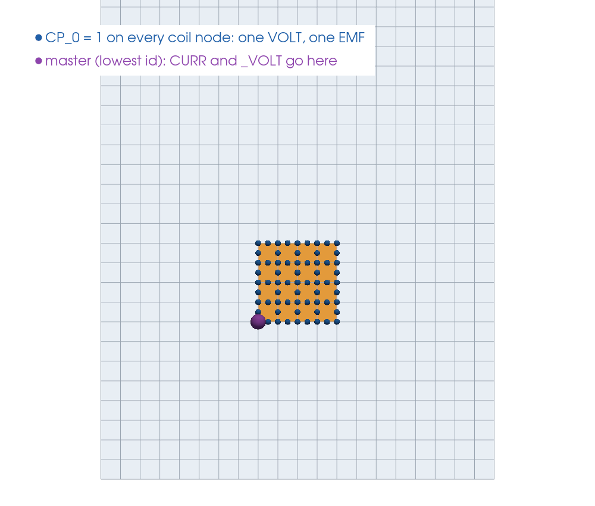
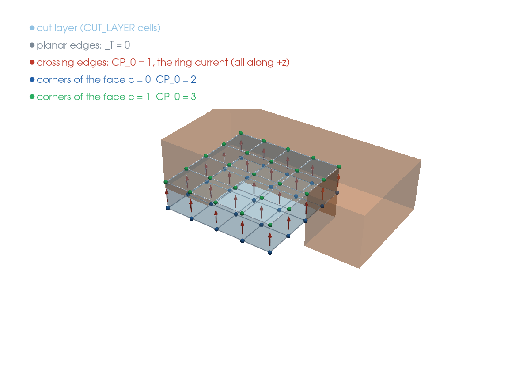
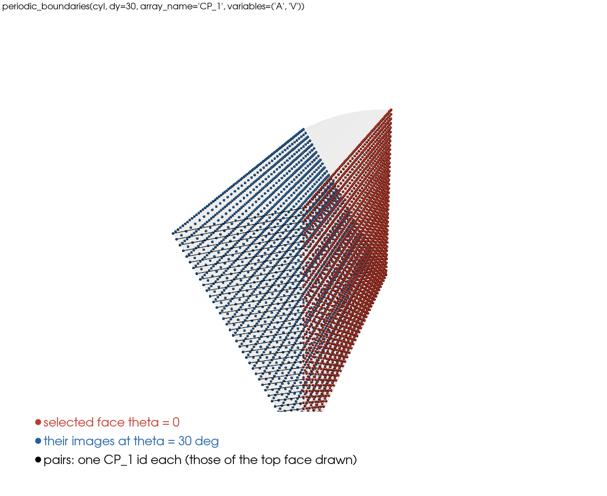

DOF Couplings and Periodic Boundaries
=====================================

A DOF coupling makes a group of nodes share the value of some fields. It is used for:

* **terminals**: one V for the whole cross-section of a 2D circuit-coupled conductor, one VOLT and one EMF for a
  stranded coil, one V for an equipotential terminal face of a 3D conductor;
* **cyclic (periodic) symmetry**: the field on one sector face equals the field on the other face;
* **cuts** of the T-phi types: the crossing edges of a cut share one T value, the net current of a conductor
  (:ref:`el-cuts`, below);
* any other "same value" condition between nodes.

How couplings are defined
-------------------------

Two ingredients:

#. a **point array** ``CP_k`` (``CP_0`` always exists; add ``CP_1``, ``CP_2``... when a node must belong to more than
   one coupling): the nodes with the same positive integer id in that array form a group;
#. the model data section ``dof_couplings``: the fields each id couples, ``{"<id>": ["VOLT", "EMF"]}``.

.. code-block:: python

   selection.select(mesh, "MATERIAL", 23, location="elem")
   selection.nsle(mesh)
   selection.set_value_on_selection(mesh, "CP_0", 1)          # group 1: the nodes of the coil
   solver.model.add_dof_couplings({1: ["VOLT", "EMF"]})       # or in model_data.json

In each group the node with the **lowest id is the master**; the other nodes are constrained to its values. Put the
loads and Dirichlet values of a terminal on the master node:

.. code-block:: python

   master = selection.selected_ids(mesh, "node")[0]           # the lowest id of the selection

   A coil terminal (``examples/coil_2D_avoltemf``): CP_0 = 1 on all the coil nodes; the master node (lowest id) carries the loads and Dirichlet values of the group.

Rules:

* every positive id of a ``CP_k`` array must have an entry in ``dof_couplings``;
* the fields must be DOF fields of the element type; a field that does not exist on a node of the group is simply
  not coupled there (e.g. ``VOLT`` on the nodes of a conductor, whose field is ``V``);
* groups are built when the model is loaded: set the ``CP_k`` arrays (and ``node_angles``) before
  ``load_model_into_solver()``; the solver stops with an error if they change afterwards;
* ids must be unique across the ``CP_k`` arrays of the model (``periodic_boundaries`` takes the next free ones).

Vector fields are coupled component by component **in the nodal frames** of the two nodes (``node_angles``): with the
frames of the second sector face rotated by the sector angle, the coupled components are the same cylindrical
components on both faces.

Coupled edges: the cut of a conductor (T-phi)
---------------------------------------------

The crossing edges of a cut layer are coupled on one DOF, the net current of the conductor. An edge value is a
circulation in the edge's own orientation, so the solver must know which way each edge crosses the layer: the corner
nodes of the two faces of the layer get two more ids, which only give that orientation:

.. code-block:: python

   selection.select(mesh, "ID", crossing_mids)                # midside nodes of the crossing edges
   selection.set_value_on_selection(mesh, "CP_0", 1)          # the coupled DOF
   selection.select(mesh, "ID", corners_face_0)               # corner nodes of the face c = 0 of the layer
   selection.set_value_on_selection(mesh, "CP_0", 2)
   selection.select(mesh, "ID", corners_face_1)               # corner nodes of the face c = 1
   selection.set_value_on_selection(mesh, "CP_0", 3)
   solver.model.add_dof_couplings({1: ["T"], 2: ["T"], 3: ["T"]})

   The cut of ``examples/ring_3D_tphi``: the CUT_LAYER cells spanning the hole, ``_T`` = 0 on the planar edges, the crossing edges coupled on one DOF (CP_0 = 1, the ring current), the corners of the two faces labelled 2 and 3.

Its value is the current from the face 2 side to the face 3 side; ``VLTG`` on one coupled midside node is the voltage
around the conductor. Each conductor takes its own three ids; conductors in series share them (one current, and
``VLTG`` is the voltage of the whole series loop); conductors in parallel keep their own ids and get the same ``VLTG``.
Examples ``examples/ring_3D_tphi`` (one ring), ``examples/rings_3D_tphi`` (two rings in series and in parallel).

Periodic (cyclic) boundaries
----------------------------

:meth:`pytec3d.model.Model.periodic_boundaries` pairs the selected nodes of one face with the nodes of the image face:

.. code-block:: python

   from pytec3d import mesh as meshes, YAxisCylindricalCoordinateSystem
   import vtk

   cyl = YAxisCylindricalCoordinateSystem()
   meshes.remove_array(mesh, "CP_1")                               # a fresh array for the pairs
   meshes.add_array(mesh, "CP_1", dtype=vtk.VTK_INT)

   selection.select_pos(mesh, 1, (-1e-5, 1e-5), coordinate_system=cyl)        # nodes of the face theta = 0
   pairs = solver.model.periodic_boundaries(cyl, ("A", "V"), dy=30.0, array_name="CP_1")

   # Nodal vector potential: rotate the frames of the image face by the sector angle
   selection.select_pos(mesh, 1, (30 - 1e-5, 30 + 1e-5), coordinate_system=cyl)
   selection.set_value_on_selection(mesh, "node_angles", 30.0, 2)

   Cyclic symmetry of ``examples/coil_3D_avoltemf_edge`` (seen from above): every node of the face theta = 0 (corner and midside) and its image at 30 degrees share a CP_1 id.

Each selected node is moved by ``(dx, dy, dz)`` in the coordinates of the coordinate system (``dy = 30`` turns by 30
degrees in a cylindrical system; a Cartesian system gives a translation), matched with the nearest node (within
``tolerance``), and both nodes get a new CP id in ``array_name``; the ids are added to ``dof_couplings`` with the
given fields. Nodes already coupled in that array, and nodes without an image, are skipped (the log reports how
many). Returns ``{cp_id: fields}``.

Guidelines:

* select the whole face, including its corner and midside nodes (edge elements are coupled through their midside
  nodes; the relative orientation of the edges is handled by the solver);
* leave out the nodes on the axis if they have their own conditions, and avoid coupling nodes that are also fixed
  by a Dirichlet value with a different value;
* with **edge elements** no frame rotation is needed (edge values are scalars), but pass the CP array to
  ``tree_gauge(mesh, periodic_point_coupling="CP_1")`` so that the gauge tree accounts for the identified edges;
* couple ``V`` for conductors crossing the faces, ``A`` always.

Examples: ``examples/coil_3D_avoltemf`` (30 degrees, nodal), ``examples/coil_3D_avoltemf_edge`` (edge),
``pyTEC3D_APDL_benchmarks/suites/simple/cases/sphere_coil_3D_period`` (90 degrees), ``examples/ITER_3D_evol_coils_edge`` (2 degrees).
